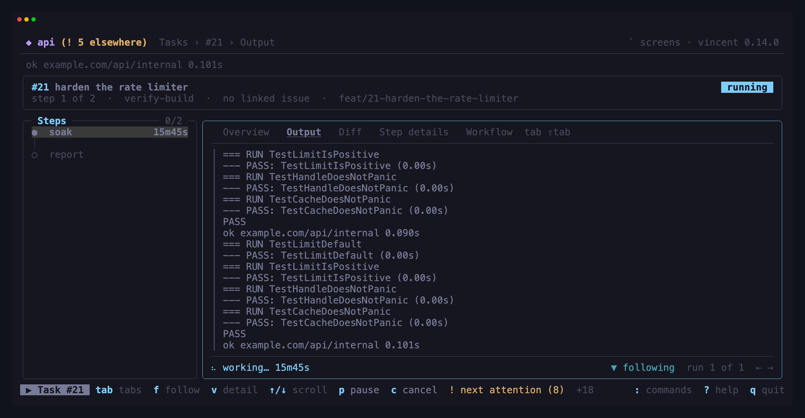
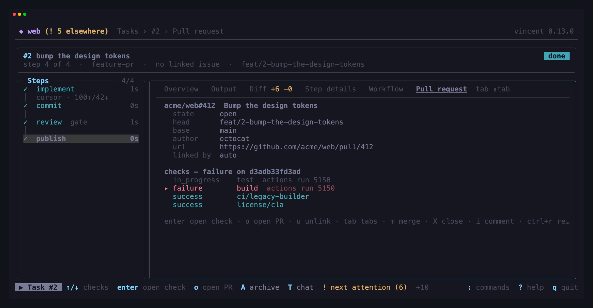
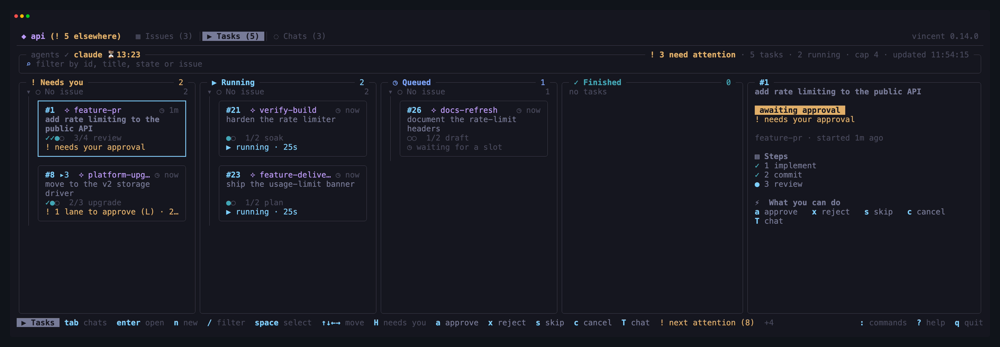
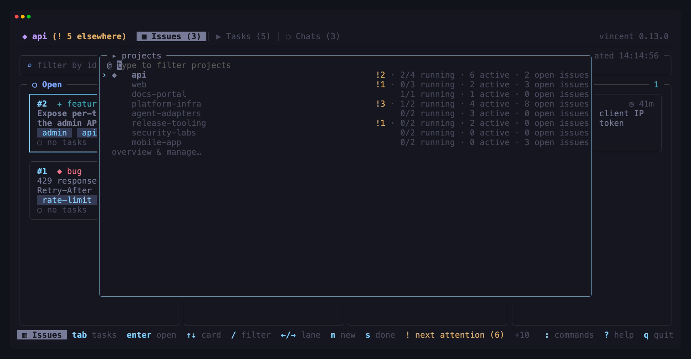

# Using the TUI

`vincent` with no arguments opens the terminal UI, starting a daemon if none is
running. It is a pure API client: it holds no state the daemon does not have,
and quitting it never affects work.

```sh
vincent          # opens the TUI
```

- [The first run](#the-first-run)
- [Layout](#layout)
- [Monitoring in three questions](#monitoring-in-three-questions)
- [The board](#the-board)
- [Acting on several tasks at once](#acting-on-several-tasks-at-once)
- [Task detail](#task-detail)
- [Answering a question](#answering-a-question)
- [The takeover screens](#the-takeover-screens)
- [The command palette](#the-command-palette)
- [Glossary](#glossary)
- [Every key](#every-key)
- [Rebinding keys](#rebinding-keys)
- [Mouse, selection and paste](#mouse-selection-and-paste)
- [When the daemon is unreachable](#when-the-daemon-is-unreachable)

---

## The first run

The very first launch shows a one-time notice: **agents run full-auto by
default and can execute arbitrary commands as you**. Acknowledge it once and it
does not return. The acknowledgment is stored in `{data_dir}/tui.json`.

It is worth reading rather than dismissing — [Security model](../security-model.md)
is the longer version.

## Layout

vincent opens on the first of your [main tabs](#main-tabs) — by default the
issues list — and `tab` reaches the task board, which is the board and
nothing else:


The redesigned screens use the width you give them. Wider terminals add panes
beside the main one, such as a preview or a details column, and narrower ones
keep the essentials. Icons are plain Unicode unless you set
[`tui.icons: nerd`](../reference/configuration.md#tuiicons) for a terminal using a
Nerd Font. On macOS and Linux, `U` on the Daemon screen sets one up: it says what
it will download, installs the font for your user, then shows you sample icons and
turns them on only if you say they look right.

`enter` opens the selected task in a separate full-screen workspace, on its
**Overview** — or, from 130 columns, where the steps are beside the tabs, on
**Output**. A band across the top names the task, its state, its step, its
workflow, its branch and the issue it is linked to — `i` opens that issue from
any tab, and `esc` there brings you back. From 130 columns the steps are a
rail on the left. The tabs are **Overview**, **Output**, **Diff**, **Step
details**, **Workflow** and, on a task with a linked pull request, **Pull
request**; below 130 columns **Steps** is a tab too, after Overview. `tab`
moves through them in the order the strip draws them and `shift+tab` goes
back; there are no digit keys. The Diff tab shows the task's change size
beside its name once a diff has been read, and Overview a red `!` while the
task needs you. `esc` returns to where you
opened the task from: the board, or the issue it was started from. A task
opened any other way — the command palette, pull requests, triggers, `!`, a
new task — returns to your [main tab](#main-tabs), and so does a project
switch while the task board is not one of your tabs.

New task, projects, workflows, chats, the archive, issues,
triggers, daemon, and — for GitHub projects — pull requests are full-screen
takeovers too. `esc`
closes one layer at a time (popup → task/screen → selection → filter) and
**never quits**; closing a takeover takes you back to the main tab you came
from — or to the first one, if that tab has since been removed from
`tui.tabs`.

### Main tabs

The board, the issues list and the chats board can be **main tabs**: the
screens [`tui.tabs`](../reference/configuration.md#tuitabs) lists, by default
`[issues, tasks, chats]`. On one of them, `tab` switches to the next in that order and
`shift+tab` to the previous, wrapping round; the footer's `tab issues` or
`tab tasks` names where it goes. It only switches when there are two or more,
and never while something on the screen has the keyboard: typing in the board's
filter, the first `tab` commits the filter and the second switches; an open
issue form or new-chat form keeps `tab` for its fields. It works while the
daemon is unreachable too, over what the screens last showed.

The app header starts with the project, then shows the tabs with how many things
each holds — `◆ api  ▦ Issues (10) │ ▶ Tasks (26) │ ◌ Chats (4)` — the one you are
on highlighted, and vincent's version at the far right. Click a label to switch to
it; a click follows the same rule as `tab`, so it does nothing while you are typing
in a filter. As the terminal narrows the version goes first, then the count of
attention elsewhere, then the tab counts, and the labels shorten to initials
(`I │ T │ C`) before the project name does; they are never dropped. The strip only appears where `tab` switches: the
task workspace, an issue, the archives and the management screens keep their
own name or breadcrumb, as does the new-chat form, which uses `tab` for its
fields. With a single tab in `tui.tabs` there is no strip.

Everywhere else `tab` means what it always did — the task workspace's tabs, a
form's fields, a screen's panes. `esc` never leaves a main tab: once the
screen's own filter or form is closed, it stays put, as it always has on the
board. The issues list, the chats board or the task board that is *not* in
`tui.tabs` is a takeover like any other: `esc` goes back to your tab. The
palette's **tasks** row and `!` reach the board from anywhere.

vincent starts on the first tab before it has reached the daemon, so it is
usable from the first frame. If your `tui.tabs` starts with something other
than `issues`, the first answer from the daemon moves you there once — unless
you have already moved. Editing `tui.tabs` later never moves you: a screen you
removed stays up until you leave it.

At **128×24 and above**, New task, Projects, and Workflows use that room as a
guided two-pane surface: progress or resources stay in a narrow rail, and the
current decision gets the rest of the screen. Below that size they fall back to
the compact form, table, or registry. Resizing does not move the cursor or close
the picker, editor, project form, workflow expansion, or graph you were using.

### The startup project

The header names one selected project, `◆ web`. When the TUI starts it picks
that project once, by the first of these rules that names a registered project:

1. `vincent --project <name|id>`: a project name first, then a project id.
2. The directory you launched from: the project whose checkout, or whose task
   or chat worktree, contains it. When several do, the deepest wins, so running
   `vincent` inside a task's worktree opens that task's project.
3. [`tui.default_project`](../reference/configuration.md#tuidefault_project) in
   `config.yaml`.
4. The project you had selected last time, kept in `tui.json`.
5. The first project by name.

A rule that names a project that is not registered is skipped, and a line under
the header says what was skipped and what was shown instead, for example
``tui.default_project `api` is not registered — showing `web` (last used)``. A
pick by the directory is announced too (`◆ web — from the working directory`);
the other rules are silent. The line goes away at your next key.

Every selection is remembered as the last used, the startup pick included, so a
`--project` launch makes that project the one the next plain `vincent` opens on.
With several TUIs open, whichever selected a project last wins.

## Monitoring in three questions

Watching work in vincent comes down to three questions, and each has a short
path through the board and the task workspace. The words for states and
reasons used below are defined in the [Glossary](#glossary).

### What is happening now?

The board answers it at a glance. Each row's state cell and `STATUS` column
say what the task is doing; a fan-out parent names its lanes by state, as in
`waiting on lanes (×1 !1 ●1 ✓2)` — see [The board](#the-board) for every
glyph. `enter` opens the task on its **Overview**, which for a running task
names the current step and attempt. The breadcrumb in the header says where
you are, and the dim line under it follows what the running attempt is doing
right now, whichever tab you are on.


`enter` opens **Output**, the whole task as one feed. The line pinned under it
shows the verbosity level when it is not `normal`, `raw` while `ctrl+o` is on,
and — for a live attempt — the spinner with the elapsed time, its cost and
`▼ following`, or `▲ N new below · f` once you have scrolled away from the
tail. See
[How the pane reads](#how-the-pane-reads).



### Where and why did it fail?

`!` jumps the board's cursor to the next task that needs you; `H` narrows the
board to those tasks and `H` again shows them all. Once the selected project
has nothing left, `!` crosses into the next project by name that does,
switches to it and opens its task, saying so on the status line
(``! — switched to `web` (task #42 needs you)``); with nothing elsewhere it
wraps to the selected project's first. The app header's `(! 2 elsewhere)`
says how many tasks in other projects are waiting, whichever screen you are
on, and the bell rings for every project — but only while the terminal is in
the background. A terminal that never reports focus (tmux with `focus-events`
off, its default) cannot say so, and rings for a task's question whatever
you are looking at, as it always has. Chats asking you a question count and are on `!`'s walk too
([Chats](#chats)). `enter` on a blocked task
opens a **failure card**: the step and attempt that stopped, the reason in
words with its code dim beside it, the last lines of the failing attempt's
output as evidence, and the actions that answer the reason — `r` retry, `E`
edit and retry, `R` repair, `T` chat. `enter` from the card opens Output where
the attempt failed, and `N` walks every failure in the task, a blocked lane's
included. See [Task detail](#task-detail),
[Jumping between failures](#jumping-between-failures) and
[The action bar](#the-action-bar).


### What did it deliver?

`enter` on a done task opens an **outcome card**: the result the last
successful agent attempt reported, the changes and commits on its branch, and
the linked pull request with its checks. `w` opens the output of the attempt
the result came from, `enter` opens **Diff**, and `tab` reaches **Pull
request** when one is linked. See [Task detail](#task-detail), which covers the outcome card
and the Pull Request tab, and [The Diff tab](#the-diff-tab).




## The board

The Tasks tab is a board of four columns, so what needs you is always first:

- **Needs you** — blocked, waiting for an answer, or waiting for approval, and a
  fan-out parent one of whose lanes is;
- **Running** — working now, or waiting on its fan-out lanes;
- **Queued** — waiting for a slot, held until a limit resets, or paused;
- **Finished** — done or cancelled.



Each card shows the task's id, workflow and age, two lines of title, one dot per
workflow step with the step it has reached, a linked pull request as `⇡#123`, and
one status line that says what is happening, such as `! needs your approval` or
`⑂ 2 of 3 lanes done`. A parent whose lane needs you leads with what the lanes
need, in the attention colour, and names the key that hangs them under the card:
`! 1 lane blocked (L) · 2 of 4 done`. The selected card has a thick border.

| Key | Does |
|---|---|
| `↑` `↓` | Move through a column |
| `←` `→` | Cross to the next column that has a card |
| `pgup` `pgdown` `home` `end` | Move further within the column |
| `enter` | Open the task |
| `/` | Filter by id, title, state or issue |
| `H` | Show only what needs you |

The filter box's top edge counts the tasks, says how many are running against the
concurrency cap, and shows any agent that needs a look. A terminal too narrow for
all four columns shows the ones around your selection, with `‹` and `›` where more
are hidden. From 170 columns a preview of the selected task sits on the right: its
steps, its issue across the board, and the keys that act on it now.

Elapsed time is **wall clock** from the task's start, so a task idle on a human for
35 of its 40 minutes never reads as 5 minutes.

### Switching project

`@` opens the project picker over whatever is on screen — or click the header's
`◆` segment, or run **switch project** from the palette, which is the way in
from a chat's composer, where `@` mentions a file. It lists every registered
project, the selected one marked `◆` and the one `tui.default_project` names
marked `★` (a row can carry both), each with the figures that say where work is
waiting:



- `!3` — tasks that need you: awaiting input, awaiting approval or blocked.
  Absent at zero, and never counting a chat waiting on you.
- `1/2 running` — tasks holding one of the project's slots, against its own
  cap. A project with no cap of its own reads `1 running`: only the global cap
  applies to it.
- `4 active` — tasks not yet finished.
- `5 open issues` — local and imported alike.

The figures follow the daemon while the picker is up. On a narrow terminal they
drop from the end — issues, then active, then running, then attention — and the
name shortens last; the `◆` and `★` marks never do. A daemon that could not
count shows the names alone. Changing `tui.default_project` in the TUI's config
editor moves the `★` straight away, even with the picker open; an edit to
`config.yaml` itself shows after the next reconnect.

Below the projects, the last row, **overview & manage…**, opens the
[project overview](#projects). It is not a project: the filter never hides
it, and choosing it changes no selection.

| Key | Does |
|---|---|
| typing | Filter the projects by name; `ctrl+v` pastes into the filter |
| `↑` / `↓` | Move the highlight |
| `pgup` / `pgdown`, `home` / `end` | Page the list, or jump to its first or last row |
| `enter` | Switch to the highlighted project — or, on the last row, open the project overview |
| `esc` | Close without switching |

A switch keeps you where you are. The board, the chats and issues lists, pull
requests, both archived boards, workflows and triggers stay on screen and
reload for the new project; the daemon and projects views are not tied to one.
A screen about one object of the old project falls back to its list: a task's
workspace to the board, with its `esc` history cleared; a chat to the chats
board; an issue to the issues list. An empty new-task, new-chat, new-issue,
new-workflow or new-trigger form is reopened for the new project, and a
workflow or trigger editor, the workflow graph and a trigger dry run close,
since each is on a file of the old project.

A form you have typed into — or a chat's composer holding an edit of a
queued message — asks first, in one line under the header:

```text
discard the task draft and switch to `api`? y/n
```

`y` discards it and switches — you land on a fresh form for the new project,
or on the list behind a workspace or issue form. `n` or `esc` keeps the draft
and the current project; nothing is switched or saved. A form seeded from a
pull request, an issue or a chat counts as a draft before you type, and so
does a workflow fork prompt, which is seeded from the old project's list.

Leaving the new-task form any other way asks too, once you have typed into
it: `q` asks `discard the task draft and quit? y/n`, and going to another
screen — a tab, the palette, `!` — asks `discard the task draft and leave?
y/n`. `ctrl+c` never asks. A form whose create is on its way asks nothing:
the task it lands on is where it was going.
A chat's unsent message does not ask: it is the chat's [draft](#drafts-stash-and-prompt-history),
which the switch saves.

Opening a task, chat or issue of another project switches to that project
first, so its screen never draws under the wrong header. This happens from the
board, a pull request, an issue's linked tasks, a trigger's delivery ledger, a
lane or parent jump, and when a task you just created belongs elsewhere. One
line says so — ``switched to `web` `` — until your next key. The task
workspace's `esc` history starts over in the new project. If you are holding a
draft, the same confirmation asks, and `n` cancels the open too.

If the selected project is deleted — here, from another terminal, or while
the daemon was unreachable — the TUI moves to `tui.default_project` when that
names a registered project, and otherwise to the first project by name. One
line says what happened:

```text
project `api` was deleted — showing `web` (default project)
```

With no project left the header reads `◆ no project` and the line says
``no projects remain``. A form you have typed into still asks first, but
only `y` answers: the project it belonged to is gone. If instead the
project you were *switching to* is deleted while that confirmation is open,
the question goes away and you stay where you were, draft intact. A rename of the
selected project shows in the header straight away, and the next launch
opens on it under its new name.

With no project registered, every project screen — the board, the archived
boards, chats, issues, pull requests, workflows, triggers and the new-task
form — says so and points at `@`, whose last row opens the overview where
you add one. Workflows and triggers say it above what they still list: the
global and built-in workflows, and the triggers of removed projects. The first project you add is selected.

While the daemon is unreachable `@` still opens, on the last list it had,
marked `offline — list may be stale`. A switch made then takes effect when
the connection returns: the screens whose loads failed reload for the
selected project, and nothing else is refetched.

### Issue groups

Inside every column, tasks are grouped under the issue they belong to, and tasks
with no issue sit under **No issue** at the bottom. The selected task's issue is
highlighted in every column, so you can follow one piece of work across the
board. The preview adds up how many of the issue's tasks need you, are running,
are queued and have finished.

| Key | Does |
|---|---|
| `f` | Fold the issue group under the cursor, or open the one the cursor rests on |
| `C` | Fold every group |
| `O` | Open every group |
| `L` | Show or hide a fan-out's lanes under its card — on a lane, its own lanes, or back to its parent |

### Fan-out lanes on the board

A fan-out's lanes are tasks, but they are not cards of their own: a column
counts the work someone asked for. A parent card says it has lanes with
`▸3` after its number. Press `L` on it and its lanes hang underneath as small
boxes, in the parent's column whatever state each lane is in — the lane's name
and number, then its state, the step an unfinished lane is on and, for a
blocked one, why. `↑`/`↓` walk onto them like cards, `enter` opens a lane's
workspace and `esc` comes back. A lane that fans out again wears its own
`▸`; `L` on it unfolds its lanes one level deeper. `L` on a lane with none
folds its parent's lanes and puts the cursor back on the parent. The boxes
follow the lanes live, and what is unfolded lasts until you quit.


Groups in **Finished** start folded, and the other columns start open. A folded
group keeps a line saying what it holds. The cursor can rest on it, but it is not a
task, so the action keys and `space` do nothing there; `enter` opens it. A fold can
never hide work waiting on you: `!` opens the group it lands in, and a group opens
by itself when a task in it starts waiting. Folds last until you quit.

### Acting on several tasks at once

Archiving yesterday's finished work one row at a time is the same keypress ten
times with a confirmation between each. Select the tasks instead:

| Key | Does |
|---|---|
| `space` | Select the task under the cursor (again deselects) |
| `V` | Select every task the filter is showing — or clear that selection |
| `esc` | Clear the selection |

While anything is selected, a `✓` appears beside those rows, the panel title
counts them (`Tasks · no issue — 5 selected` on api's board, where the
title already names its one group), and the **action keys act on the whole
selection**:


The count beside each key is how many of the selected tasks that action can
actually move — an action shows up when *some* selected task accepts it, and the
ones that do not are left alone. So a selection holding four finished tasks and
one still running offers `A archive (4)`, and the running one stays where it is.

The rest of the behavior follows from what a selection is:

- **It is a set of tasks, not of rows.** Filtering, regrouping and refreshing do
  not change it — that is why the count is in the title, so a selected task the
  filter is hiding still says it is coming along.
- **One confirmation for the batch.** `A` asks once, about all of them. Behind
  the scenes vincent sends one ordinary action per task, so the daemon sees
  nothing special; you get one line back: how many moved, and the first refusal
  named if any refused.
- **Uncommitted changes still re-prompt.** A bulk archive archives the clean
  worktrees and asks again about only the dirty ones —
  `2 of 5 selected tasks have uncommitted changes`.
- **An archive git refuses offers a force delete.** When an archive fails on
  the worktree itself, such as a `git_error`, the line asks
  `force delete #7? (y/n)` instead, for that task or for the selected ones that
  failed. `y` removes them from whatever state they are in, cleans their
  worktrees as far as it can and keeps their branches. The chats board, the
  archived boards (after a refused delete) and an issue whose delete its tasks
  are holding ask the same.
- **What succeeded leaves the selection; what failed stays in it**, so a retry
  needs no re-selecting.
- **The keys work from any panel.** Whatever has focus, the footer is counting
  the selection, so that is what `A` acts on.

## Task detail

From 130 columns wide, a task opens as one workspace: its name, state, reason
and linked issue across the top, its steps on the left, and the tabs beside
them. When a task is blocked, the reason, a short form of the failure card's
evidence — how the attempt exited and up to three lines of what it printed —
and the keys that can restart it are pinned under the tab. On a narrower
terminal the steps are a tab.

The **steps rail** gives each step one row — its state glyph (`✓` done, `●`
running, `✗` failed, `!` waiting on you, `○` not reached), its name and how long
it took — joined by a line. A dim row under a step says something only when
there is something to say: why it failed, how many attempts it took, the agent
and what it cost. The step you have selected lists its attempts when it has
more than one; a parallel group lists its members, a loop its passes as a row
of pips (`✓ ✓ ● · ·  3 / 5`), and a fan-out its lanes as a tree, with earlier
rounds one line each. `←`/`→` on Output move the selection through the
attempts, and a click selects the row under it.


`enter` opens the selected task on its **Overview** — from the board, the
palette, a lane jump or the pull requests takeover alike, and after `!` has
moved the board's cursor to a task that needs you. `esc` back out of a lane
returns you to the tab you left its parent on instead, and the takeover's
"open a pull request" route opens on the Pull Request tab, where its form is.

The app header says where you are as a breadcrumb — `Tasks › #12 › lane #14
api › Output` — naming each task you drilled through, the task on screen and
the tab, so it also says where `esc` goes. On a narrow terminal the leftmost
crumbs give way to `…` first. The task's `#id` and title are the first line
of the workspace on every tab. While the task is running, a dim line under the
header says what it is doing right now: the running attempt's latest status
message after `»`, or else the last line it printed, or else just the
attempt's name. It follows the live output whichever tab you are on, and goes
away when the task stops running.

The Overview answers the question the task's state raises, from the task the
workspace has already loaded:

- **Running, queued, paused, or waiting on its lanes** — what it is doing: a
  sentence for the state (how many lanes are still out, for a fan-out parent),
  the current step and attempt, and — except while it runs, when the line
  under the header says it — the attempt's latest status message.
  A bar under the sentence has one segment per step. `enter full output`
  jumps to that attempt's output; a task with no output yet links its steps
  instead. A fan-out parent waiting on its lanes lists the
  ones that are blocked or waiting on you under *Lanes that need you*, `l`
  opens the first, and its link is its steps — the parent's own transcript is
  empty. Under *Waiting on* it names the first few lanes still at work. Every
  lane row says the step and attempt the lane is on, and marks a step failing
  attempt after attempt for the same reason: `attempt 6 · attempts 2–5 each
  failed: check failed`.
- **Blocked, waiting for an answer or at a gate, or aborted** — what it needs:
  the reason, in words and as its code, the question or the gate's
  instructions, and every action the daemon offers with its key and a line on
  what it does. `enter output of attempt N` jumps to the attempt it stopped
  on, and `enter` there again shows what it was given.
- **Done or archived** — how it ended: an **outcome card** (below) and
  `enter diff`.

A running task pairs a **Now** card — the current step and attempt, the latest
status, the last line it printed — with **The task**, the description and
priority. Under every frame, a **Linked** card names the task's issue (with
`i`), pull request, chat, branch and base, and a **Usage** card its elapsed
time, tokens, cost, workflow and worktree. `↑`/`↓` move a cursor along the
Linked rows that open somewhere, and `enter` opens the one under it. Below
the cards is the task's whole document.

A **blocked** or **aborted** task's Overview is a **failure card**. Its first
line says what stopped: `✗ Step 3 verify · attempt 2 · check failed
check_failed` — the step, the loop iteration and item or the lane when there
is one, the attempt, and the reason in words with its code beside it. `✗` is a
failure, `⚠` a fan-out one of its lanes stopped, `■` an aborted task, so the
card reads without colour. Under the reason's meaning, a step that has failed
the same way before says so: `↻ same failure as attempts 2–5`. Below it:

- **Evidence** — what the failing attempt's transcript says, fetched once
  when the card first shows that attempt. It opens with the command that
  failed (`$ go test ./...`, its first line and a count of the rest) and
  which part failed and how: *the check exited 1*, or *the command printed
  nothing and exited 1* when there is nothing to quote. Then up to twelve
  lines of what it printed, fewer on a shorter screen, chosen rather than
  taken from the end: lines that name a failure (`--- FAIL`, `error:`,
  `fatal:`, `panic:`) and what is indented under them come first, then
  stderr (marked with a red bar), then the last lines; a `⋯` row marks lines
  left out between two quoted ones. For a failed check they are the check's
  own output, not the agent's last message. `enter` opens that attempt's
  output at the line it failed on, under the same `$` line. A block that no
  step ran into — a dirty worktree, a missing container runtime — shows the
  daemon's explanation instead; when there is none, the card says the details
  are in the daemon log (`:` then *daemon*).
- The step's **last status before the failure**, quoted — what it last said,
  which is not the reason it stopped and may name a stage it had already
  passed.
- For a fan-out, **which lane** stopped it, the lane's task and what the lane
  is stuck on; `l` opens that lane.
- **What you can do** — the actions that answer the reason first (retry, with
  `E` edit & retry right after it, then skip, repair, chat), then everything
  else on offer, each with a line on what it does.

An aborted task's card is muted and shows no evidence; it offers what the
daemon offers, which never includes retry. The card spends the rows it has
in order: its first line and its actions, the jump links, the reason's
meaning, the evidence (shrunk before it is dropped), then the status — so a
taller terminal never shows fewer of its keys than a shorter one. Only when
even the first line and the actions will not fit does it collapse to its first
line and a row of action keys. An Overview taller than the screen scrolls with
`pgup`/`pgdn`, `home`/`end` and the wheel, and its last row says what is above
and below.

A **done** or **archived** task's Overview is an **outcome card** — what the
task delivered. An **aborted** task shows one too, under its failure card,
headed *incomplete — what was delivered*. On a short terminal the outcome card
shrinks first, and on an aborted task it goes before the failure card does.
The card shows:

- **Result** — the summary the task's last successful agent attempt reported
  (a follow-up round counts), rendered as Markdown and given every row the
  Overview has free.
  With no successful agent attempt it is the newest attempt that reported
  anything, and with none of those the task's own status message, labelled
  dim as such. The label always says where it came from — `from step 2
  implement · attempt 2`, with the loop iteration and item when there is one
  — and `w` opens that attempt's output at its end.
- **Changes** — `± 4 files · +120 −8 · branch vincent/12-…`, counted from the
  task's diff, which is fetched once when the card first shows. An archived
  task has no worktree, so it says `worktree removed — branch … kept`
  instead, or `… gone` when archiving deleted a branch with no commits.
- **Commits** — how many the task made on its branch and the newest three
  subjects. A daemon too old to serve them, or a branch that is gone, leaves
  the line out.
- **Pull request** — `⇡ #123 open · checks 5/5 ✓ passing` when one is linked,
  read from the same pull request and check rollup the Pull Request tab shows.
- **Cost and time** — the cost (the whole tree's, for a task with lanes) and
  the active time its attempts took, then `N lanes merged` and `loop ran K
  iterations` when either is not zero.

Every marker is a glyph with a word beside it, so the card reads without
colour. The diff and the commits are fetched once each time the task is
opened, never again while you watch it.

The link is on `enter`: it first moves the attempt selection to the attempt
the Overview is about, then opens the tab, so Output shows that attempt. On an
aborted task it stays the failure card's link; the outcome card's result has
its own key, `w`. The footer names the link the current frame draws.
If the task changes state while the Overview is open, the new frame replaces
the old one and your attempt selection stays where it was.

A handoff's task — one a [handoff](#handing-issues-off--space-v-i) started —
adds an **Items** block to its Overview: each issue it claimed, by id and
title, with its delivery kind and its outcome, or `unresolved`. It is read
again whenever an item's outcome changes or the handoff settles.

**Steps**, a tab only below 130 columns where there is no rail, lists every attempt of every step with its duration, tokens and
cost. Selecting
an attempt chooses what the separate **Output** tab shows; the selection stays
put while you move between tabs. Press `enter` on an attempt to jump straight
to its output.


**Task Details**, the complete task document, is the Overview's lower half,
below the Linked and Usage cards: title, description, declared fields, state,
project, workflow and its recorded origin, branch and worktree, priority,
tokens and cost, lifecycle timestamps, queue/block information, pending input,
fan-out/loop metadata, the [chats opened on it](#talking-to-an-agent-about-a-task),
the issue it was started from, available actions, and the task's workflow-step
snapshot. `pgup`/`pgdn` scroll the Overview down to it, and the command
palette's *open the task's details, section by section* opens the inspector
that reads it one section at a time; nothing there edits anything.


Its **GitHub pull request** section follows the captured issue and shows one of
three things: the pull request linked to this task with its live state, the
reason the integration is unusable, or — when nothing is linked — the offer to
open one. Two keys work on the Overview for it:

| Key | Does |
|---|---|
| `o` | Open this task's pull request in a browser |
| `P` | Push this task's branch to `origin` and open its pull request — the title, body and draft flag are editable first |

`P` opens a small popup with the title and body vincent guessed from the task,
plus a draft toggle — all three editable:


| Key | Does |
|---|---|
| `↑` / `↓` | Move between the title, the body and the draft row |
| `enter` | Edit the row under the cursor, or toggle the draft row |
| `space` | Toggle draft / ready for review, on the draft row |
| `e` | Write that row in `$EDITOR` instead |
| `ctrl+s` | Push the branch and open the pull request |
| `ctrl+o` | Open GitHub's own new-pull-request page with this prefill instead |
| `esc` | Close without sending anything — the draft is discarded |

Inside a field `enter` is a newline (a pull-request body usually wants more than
one line), `ctrl+s` keeps the text, and `esc` discards it. A title is required:
`ctrl+s` without one says so rather than sending something GitHub cannot use.

The popup's footer — the compare URL, an error, the status and the key line —
stays pinned under the rows, which scroll, so a long body never hides the keys
or a failed `ctrl+s`'s reason. The URL shown leaves out the encoded body, which
is already on screen above it; `ctrl+o` still opens the full one.

`ctrl+s` **writes to GitHub.** It pushes committed work
only — anything uncommitted in the task's worktree is not in the pull request,
which the popup says above the rows — and it never force-pushes: a diverged,
protected or rejected push creates no pull request and changes nothing on the
remote. Pressing it twice sends once.

If there is no credential with write scope, or GitHub refuses the create, the
branch is still pushed and the popup points you at `ctrl+o`, whose page now
works because the branch is on the remote. The TUI itself never talks to GitHub:
every call is the daemon's.

`o` and `P` are absent unless at least one registered project's GitHub
integration is usable. Linking lives on the pull-requests screen below;
unlinking lives there and on the Pull Request tab.

**Output** is the whole task as one feed, in the order it ran. Every attempt
except the selected one is a single dashed line — its state, step, agent, how
long it took, what it cost, why it failed and the start of what it said — and
the selected attempt opens in full between a divider naming its step, agent,
attempt and start time and a closing line that says how it ended: a command's
`✗ exited 1 after 0.4s`, or the state an agent step finished in. `←`/`→` (or
`h`/`l`) open another attempt, and the rail follows. A step's script shows its
first line and how many more there are (`v` to verbose shows it whole), and
what a command printed sits behind a `┃` bar, red for stderr. While the attempt
on screen is still running, the line pinned under the pane carries the same
in-progress indicator the [chat workspace](#chat-workspace) draws — a turning
glyph and an elapsed clock, `⠋ working… 14s` — with its cost and the follow
state, so an attempt that is thinking rather than printing is told apart from a
screen that has stopped repainting. It follows the attempt being *live* rather
than its step being an `agent` step: a long `command` step's pane goes quiet for
exactly the same reason.

Each tool call is one line — what the agent ran and how it came out — folded.
`enter` unfolds the newest call in view to show its output, and folds it again;
a click unfolds the call under the pointer. The agent's plan is one row that
changes in place as it ticks items off.


**Step Details** answers the question the other tabs cannot: what this attempt
was actually *given*. Task Details shows the workflow's template; this shows the
substitution — the rendered prompt an agent step handed its CLI, the rendered
script a command step handed its shell, the rendered `check:` command. On a retry
the block vincent appends about the previous failure is marked as vincent's, so
you can tell it from what the workflow wrote. Beneath the input come the
resolution (agent, model and effort each with the level that supplied it — step,
task, workflow or adapter — the permission mode, both timeouts, the shell, the
working directory and the `include` chain the step came from), the control flow
(what an `if:` guard rendered to, the loop iteration and total, this iteration's
`for_each` item and the whole resolved list) and the outcome (tokens, cost,
durations, exit codes, reasons, the transcript path).

These are the values the attempt ran with, recorded when it ran — not recomputed
when you open the tab, which would quietly disagree once you edited `config.yaml`
or patched the task's agent. The sidebar lists attempts and shares the selection
with Output and Diff, so arriving here lands on the attempt you were reading.
Two things it says out loud rather than hiding: a record cut at its 64 KiB
ceiling, and an attempt from before vincent recorded any of this, which reads
`not recorded` instead of showing an empty prompt.


**Pull Request** is the last tab, and the only one that is sometimes not
there: it appears when the task has a pull request linked and `github.enabled`
is on. It carries the pull request's facts and one row per check on its head
commit — name, state, and the check's own page — read live from the daemon on
open, on a reconciler tick and on its own poll. Nothing about a check is
stored, because a stored check result reads exactly like a current one while
being wrong, and there is no refresh key: `R` is repair on every tab of this
workspace, and the poll is what makes a fourth trigger unnecessary. `↑`/`↓`
select a row, `enter` opens it in a browser, `o` opens the pull request and `u`
unlinks it from the task; the refusal is sticky, so the reconciler will not
link it again. Every §6 action key works here too — the tab you happen to be
reading is not a statement about what you may do to the task.


Four keys on this tab **write to GitHub**, and each asks first. A key is only
there when its write can apply — the hint line and the footer leave it out
otherwise, and pressing it does nothing:

| Key | Does | Offered when |
|---|---|---|
| `m` | Merge — a popup lists merge, squash and rebase with **none chosen**; `←`/`→` picks one, `y` merges, `n` or `esc` cancels | The pull request is open and not a draft |
| `X` | Close without merging, or reopen — asks `y`/`n` first | Close on an open pull request, reopen on a closed one; never on a merged one |
| `i` | Comment — type in the popup (or `e` for `$EDITOR`), `ctrl+s` posts, `esc` stops typing and then discards | Always, once the pull request has been read |
| `ctrl+r` | Re-run the failed jobs of the selected check's GitHub Actions run — asks `y`/`n` first, naming every failed job of that run | The selected row is a failed GitHub Actions check |

The merge popup shows the head commit it merges: the one whose checks are on the
tab. If GitHub reports a different head for the pull request, the popup says the
head moved and `y` does nothing until the tab has re-read both. `enter` never
merges. In the y/n prompts, any key but `y` answers no. A write that has not
answered yet cannot be sent a second time, and none of the four exists while
GitHub could not be read. When the daemon refuses — the branch is behind, a
check is still running, the credential cannot write — its reason is on the
tab's note line, and nothing was sent. After a write the tab re-reads the pull
request and its checks. The TUI itself never talks to GitHub: every call is the
daemon's.

**Diff** gives the task's file-grouped git diff the entire view. **Workflow**
draws the workflow this task ran as a control-flow graph with its run state on
it; it is documented beside the workflows screen's graph, under *Workflows*
below.

The header names the task's workflow and, in brackets, where that definition
came from: `adhoc (built-in)`, `adhoc (project .vincent/workflows/adhoc.yaml)`,
`release (global workflows/release.yaml)`, `api (derived from task 41)` for a
fan-out lane, or `adhoc (unknown)` for a task created before vincent recorded
it. A project or global file shadows a built-in of the same name, so the name on
its own does not say which one ran.

It sits late in the header — after the branch, before the run's cost — so a
narrow pane truncates it early;
[`vincent task show`](../reference/cli.md#vincent-task-show) prints the same
thing plus the source digest, and is where an audit is actually done.

A structure step gets a fold of its own. A `parallel` group's sub-steps share
the group's index, so the group is one header and each sub-step sits beneath
it. A `loop` (§7.8) goes one further: its body's rows are grouped **by
iteration**, folded shut with the latest one open, and a `for_each` iteration's
header names the item it ran on. Ten iterations of a four-step body is forty rows,
and the one you arrived to read is almost always the iteration it stopped on.
So you can see how the iterations went without opening them, the loop's header is
followed by one dim line, `iterations ✓✓×✓●`. It shows up to ten iterations, oldest
first, with `…+3` in front when older ones are cut. Each glyph is that iteration's
worst outcome: `×` a step failed or was rejected, `■` a `break` ended the loop,
`●` still running, `✓` everything passed or was skipped.

Folded is not unreachable. `space` opens or closes the iteration or round the cursor is in,
`→` opens it and `←` closes it, `enter` on a folded one's header opens it
(and on a drawn attempt still opens Output), and `O`/`C` open and close every
iteration and round of the task — the same two letters the Diff tab uses. Latest-open is only
where the timeline *starts*: what you open stays open while the task refreshes,
and opening another task starts fresh. `↑`/`↓` stop **once** on a folded iteration or round,
on its header, so the cursor is always somewhere you can see; the Output tab's
`←`/`→` still walk every attempt, folded or not.


A multi-round `fan_out` (§7.6) folds the same way under a different word: its
rounds read `round 0`, `round 1`, … — 0-based, because that is the number the
transcript file and the log line use — and the same keys open and close them.

A `fan_out` step is on the timeline **while its lanes run**, not only once they
have merged: the row opens `running` when the round is spawned and the merge
that ends the round finishes that same row. Since the step itself executes none
of the work, its running row carries what the subtree is doing beside the state
— `×2 !1 ●1 ✓3`, the same clauses the board puts beside `waiting on lanes` —
read live from the task rather than frozen in when the lanes were spawned. The
round is named on the row (`round 0 · ×2 ●3`) only
when the timeline is not already drawing `round N` headers above it. No other
step type is annotated.

Under its last attempt, a `fan_out` step lists its **lanes**, indented and in
merge order: `↳ ✓ api  done  #42`, one row per lane with its state, its task
number, the step an unfinished lane is on (`step 2/4 test`) and, for a
blocked lane, its block reason. A workflow that fans out
twice lists each step's own lanes under that step, and a multi-round
`fan_out` lists each round's lanes inside that round, so folding a round
folds its lanes too. A lane that fans out again reads `▸ api  running  #51 ·
6 below`: `→` or `space` unfolds its own lanes in place, one level deeper
(`▾`), and `←` folds them away — the same keys that fold a round, meaning
the lane while the cursor is on one. Nested lanes are cursor stops and open
with `enter` like any other.

 The rows follow the lanes
live. `↑`/`↓` stop on each lane as they stop on an attempt, and `enter` or `l`
on one opens that lane's workspace; `esc` comes back to the parent — see
[Walking a fan-out](#walking-a-fan-out). Standing on a lane row also points
the Output tab's lane selector at it, so Output shows that lane's output without
leaving the parent; stepping back onto an attempt returns the selector to the
task's own output, unless you chose a lane there with `<`/`>`.

The board's and the header's step column say the same thing more briefly: a
task inside a loop reads `3/7 green · loop 4/10 · repair 2/3` — the pass it is
on out of the loop's real extent (a 3-item `for_each` reads `loop 2/3`, not the
ceiling it is bounded by), and the body step that pass is on, which is the one
thing the outer `3/7` cannot say because it counts the whole loop as one step.
The header also adds the iteration strip after its loop clause
(`loop 4/5 · ledger · migrate 1/2 ✓✓×●`), and one pip per workflow step after
its step counter (`step 2/3 ✓●○`). A `parallel` group, a loop or a fan-out is
one pip, and the current step of a task waiting on you is `!`.

Two things on an attempt line are worth telling apart. A red
`check failed · check_failed` is vincent's **failure reason** — a fixed set of
constants, and vincent's own verdict, in words with its code dim beside it. A cyan `» 3 tests red in internal/store` is the step's
own **status message**, free text it set while it was running and the last thing
it said before it ended. It is never a cause: a step killed on a timeout may be
carrying a line it wrote half an hour earlier.

An attempt that did **not** succeed also gets a dim line beneath it with its
**result summary** — the agent's final message, or the tail of a command's
output. It is the sentence that decides whether to open the transcript.

| Key | Does |
|---|---|
| `tab` / `shift+tab` | Next / previous task tab |
| `]` / `[` | Next / previous task tab — except on the [Diff tab](#the-diff-tab), where they walk the hunks |
| `i` | Open the task's linked issue, from any tab but Pull request (`esc` comes back) |
| `d` | Open Diff from any tab; on Diff, switch between the whole task's diff and the selected attempt's |
| `l` / `U` | Open a fan-out lane's workspace / this lane's parent task, from any tab — see [Walking a fan-out](#walking-a-fan-out) |
| `N` | Jump to the task's next failure, from any tab — see [Jumping between failures](#jumping-between-failures) |
| `enter` | On Overview, the frame's link — the output of the attempt it is about, or a finished task's diff — or, with the cursor on a Linked row, that row |
| `↑`/`↓` | On Overview, move along the Linked card's issue, pull request and chat rows |
| `l` | On Overview, open the fan-out lane the failure card blames — or, on a parent waiting on its lanes, the first lane listed under *Lanes that need you* |
| `pgup`/`pgdn`, `home`/`end` | On Overview, scroll a frame taller than the screen (the wheel does too; the last row says what is above and below) |
| `w` | On Overview, open the output of the attempt the outcome card's result came from, at its end |
| `enter` | On Output, unfold or fold the newest tool call in view |
| | Pull request is on the strip only when this task has a linked pull request and GitHub is on |
| `m` | On Pull Request, merge it — the method is chosen in the popup, none preselected |
| `X` | On Pull Request, close it without merging, or reopen a closed one (asks first) |
| `i` | On Pull Request, comment on it (`ctrl+s` posts) |
| `ctrl+r` | On Pull Request, re-run the failed jobs of the selected check's GitHub Actions run (asks first) |
| `↑`/`↓` | On Step Details, select an attempt (`←`/`→` do it too, and move the same cursor everywhere else) |
| `pgup`/`pgdn` | On Step Details, scroll the facts |
| `enter` | From Steps, open the selected attempt in Output — or open the folded iteration or round the cursor is on, or the fan-out lane the cursor is on |
| `space` | On Steps, open or close the iteration or round the cursor is in — or, on a lane that fans out again, its own lanes |
| `←`/`→` | On Steps, close / open that iteration or round — or that lane's own lanes |
| `O` / `C` | On Steps, open / close every iteration and round of this task |
| `pgup`/`pgdn` | On Steps, move the selection a page |
| `g`/`home`, `G`/`end` | On Steps, select the first / last attempt; `↑ N more` / `↓ N more` rows say what the window hides |
| `←`/`→` or `h`/`l` | On Output, select which attempt's output to show |
| `f` or `G` | Follow the live output again |
| `g` or `home` | On Output, jump to the top (follow stops) |
| `v` | More or less detail: quiet → compact → normal → verbose (tool lines, then reasoning, the run's own metadata, then unrecognized lines) |
| `ctrl+o` | Show the assistant's original Markdown instead of the rendered view |
| `ctrl+y` | Copy an assistant message, its plain text, or one of its code blocks |
| `ctrl+l` | List the links in the assistant's messages — open one in a browser or copy it |
| `e` | Open this attempt's **whole** transcript in `$EDITOR` |
| `↑`/`↓` | Select an attempt or Task Details section, scroll Output, or move between diff files — according to the active tab |
| `pgup`/`pgdn` | Scroll the selected Task Details section |

### How the pane reads

Every record is a two-column **gutter** plus its content. What the agent *said*
is unmarked and sits flush left; what it *did* is glyphed — `·` reasoning, `▸` a
tool call with its outcome indented under it, `#` the run header, `☰` the plan.
A [subagent's](#when-the-agent-runs-subagents) work is drawn behind a `┊` rail
in front of those same marks. A monochrome terminal or an SSH session loses
nothing to that scheme, which colour alone would not survive. There are no timestamps: on an 80-column pane
they would spend nine columns of every line answering a question the timeline
already answers per attempt.

**A message is a message, however it arrived.** An agent sometimes delivers one
answer as several records. Consecutive assistant records are read as one
Markdown document, so a table, a list or a fenced block spread across them is
the one thing it was written as, and its link references are numbered once for
the whole message. Anything that is not assistant prose — reasoning, a tool
call, command output — ends the message, and what comes after it starts the
next. So does a switch between the agent and one of its subagents, or between
two subagents: their prose is never read as one message.

**What the agent said is rendered as Markdown.** Headings, emphasis, strong
text, ordered and unordered lists, nested lists, blockquotes, inline code,
fenced code and horizontal rules become terminal structure instead of literal
syntax. That structure lives *inside* the assistant column — the gutter is
untouched — and every marker is a glyph, not a colour, so a heading's `▌`, a
quote's `│`, a list's `•`/`◦`/`▪`, a code block's `▏` and an inline span's
backticks all survive with the styling stripped. A code block keeps its
indentation and its hard line breaks; a line too long for the pane continues on
the next one at the block's rail rather than being cut off. It also shows the
language the fence declared, as a dim word at the rail, and tints its body — the
tint is styling and nothing else, so stripping the escape sequences gives back
exactly the code the agent wrote, and a language vincent does not know renders
plain.

**Tables and links, too.** A table needs its delimiter row to be a table, so
prose containing a `|` stays prose. When it fits, it is drawn aligned with a
rule under the header and no borders; when the pane is too narrow for its
columns' widest unbreakable words, each row becomes a stacked
`column: value` record opened by `▪` — never a clipped grid, and never a
sideways scroll. A link renders its label as ordinary text with a dim `[1]`,
and the message ends with the `[1] https://…` lines that resolve them, one per
distinct destination. An image is its alt text plus its source in that same
list. Nothing here is fetched, and by default nothing is turned into a
terminal hyperlink: vincent emits no OSC 8, so a destination is text you can
read and copy, and it opens only when you pick it in the
[link picker](#seeing-the-source-and-taking-it-away). If your terminal supports
OSC 8, set
[`tui.hyperlinks: true`](../reference/configuration.md#tuihyperlinks) (or flip
it in the daemon view's config editor) and the label, its `[1]` and the
printed destination become clickable — but only for an `http` or `https` link
that passes vincent's sanitizer. The reference list stays either way.

Constructs outside that list — reference links, autolinks, bare URLs, titled
links, HTML, footnotes — render as the characters the agent sent, and raw HTML
is never parsed, fetched or executed.

Only the agent's prose is interpreted. Reasoning, tool calls, tool results,
command output, errors and unmodeled lines stay literal behind their own gutter
marks: a `#` in a grep hit is a `#`, not a heading. The rendering is derived
too — the transcript on disk and the API keep the agent's exact bytes, and
resizing the terminal re-renders from those rather than reflowing what was
already drawn.

The chat workspace's conversation body is this same pane, at the same level.

**Scrolling away from the tail keeps your place.** A pane that is not following
holds onto the block at the top of it, so resizing the terminal, changing the
level with `v` or `ctrl+r`, toggling `ctrl+o`, and output old enough to be
dropped from the window all leave you looking at the same thing. Press `f`
(`alt+shift+g` in a chat) to go back to following the tail.

**The line under the pane says what it is doing.** It shows the level when it
is not `normal`, `raw` when `ctrl+o` is on, which attempt is open, and — for a
live attempt only — the spinner with its elapsed time and `▼ following` or
`▲ N new below · f`. A finished attempt that failed opens where it failed: at
the first line its check printed if the check failed, otherwise at the end.
Check output is marked `check ▏` so it never passes for the step's own.

### Seeing the source, and taking it away

`ctrl+o` swaps the rendered view for the **stored Markdown**, exactly as the
agent wrote it — `#` back on the headings, backticks back on the fences. It is
the escape hatch for a render that surprised you, and it is a display state and
nothing more: the records, the live tail, the level and the transcript on disk
are untouched. Like `v`'s level, it is one choice for the whole session and
shared with the chat workspace — set it in either place and both follow. Unlike
the level, it has no config key: it is gone when you quit. The pane's title — in a task's workspace, the line
under the pane — says `raw` while it is on.

`ctrl+y` opens a **copy picker**: a searchable list of what can be taken out of
the assistant prose on screen, newest message first.

| Row | Puts on the clipboard |
|---|---|
| `markdown` | The message as the agent wrote it |
| `plain text` | The same structure with the punctuation gone — headings as their own line, `•` list markers, quotes prefixed, fences dropped |
| `code block` | One fenced block's contents, with no fence and no language label, whitespace and tabs kept |

Payloads come from the source, not from what is drawn, so the pane's width never
ends up baked into what you paste, and nothing that arrives after you open the
picker moves the row you are pointing at. A row names a message rather than a
position in it, so picking one that is still being written copies the whole
message as it stands at that moment. Escape sequences and control
characters are stripped on the way out for the same reason they are stripped on
the way in: a clipboard gets pasted into a terminal.

vincent tries your system clipboard first and, if that refuses, hands the text
to your terminal over OSC 52 — which is the one that works over SSH. The notice
says which happened, and never claims a copy it could not verify.

`ctrl+l` opens a **link picker**: every link and image in the assistant prose
on screen, one row per `[n]` the pane numbers it by, grouped under the same
`MESSAGE n` headers as the copy picker and searchable by label, message or
destination. A destination linked twice in one message is one row, because the
pane gives it one number.

| Key | Does |
|---|---|
| `enter` | Open the row's destination in your browser |
| `ctrl+y` | Copy the row's destination |
| `pgup` / `pgdown`, `home` / `end` | Page the list, or jump to either end (the copy picker too) |
| `esc` | Close the picker |

Under the rows the picker prints the selected row's **whole** destination, so
you can read exactly what `enter` would open before you press it. Only `http`
and `https` links open; anything else — `mailto:`, `file:`, `javascript:`, a
relative path — is marked `copy only`, and `enter` on it opens nothing and says
why. The result is a notice where you pressed the key — the pane's status
line, or the chat's note: `opened <url>`, the reason it could not be opened, or
the copy notice above. A screen with no notice of its own, such as an issue,
shows a copy's outcome on the line under the header until your next key. Raw mode (`ctrl+o`)
does not change the list.

### What `v` adds

`quiet` is what the agent **said**, and whatever went wrong. Below compact it
drops the `▸` tool calls and the outcomes under them, the `✓ done · …` line of a
run that succeeded, and the lines vincent's parsers do not model — not even
their count, because a count is an offer to expand and this is the level that
makes no offers. It is the level for reading an answer rather than watching a
run: a two-sentence reply arrives as two sentences instead of buried in file
reads and greps.

A failure is never hidden by a level. An `✗` result, an error line and a turn's
own fail reason all render at `quiet`, and so does the result *text* of an
attempt that printed nothing else — a codex turn with no assistant message —
which would otherwise leave a turn header with nothing under it. A command
step's pane is identical at `quiet` and `compact`: `quiet` is a rule about what
the *agent* narrated, and a command step narrates nothing.

At both, **a command's output is cut to its last 20 lines**: a command step's,
each parallel or fan-out member's, and a step's `check:` (the `check ▏` lines),
each under its own `$ …` line. When a command printed more, a dim
`… N earlier line(s) (v)` above the tail says how many are not shown — at
`quiet` too, the one count that level draws, because a tail with no count would
read as the whole output. stdout and stderr count together, so a failing
command's last line is always on screen; while it runs, the tail slides and the
count grows. `normal` and `verbose` show all of it.

The level the pane opens at is `tui.output.level` in `config.yaml`
([configuration reference](../reference/configuration.md#tuioutputlevel)),
`normal` unless you set it. `v` changes it for the session only; reconnecting
never undoes a `v` press, and changing the key applies it to a running TUI.

`quiet` also keeps what **you** did. An answered question shows as
`✓ answered`, and a skill your message invoked shows as `▸ skill <name> <args>`
— `(forked)` after it for a skill that ran as its own sub-run — so a `/tdd`
you sent visibly ran even at the quietest level. A skill the agent chose to
load is one of its tool calls and appears from `compact` up, on its `Skill`
call's line: `▸ skill echo-probe zebra` with the `✓ Launching skill` outcome
under it, rather than the call and the load as two lines. While a run is live
that line reads `▸ Skill echo-probe` for the moment before the load arrives. A
load that carries the agent CLI's refusal shows at every level as
`▸ skill <name> failed: <error>`. A `Skill` call Claude Code refuses loads
nothing, so it stays `▸ Skill <name>` with the refusal as the `✗` outcome
under it. The skill's own text — the `SKILL.md` that
was loaded — is never drawn at any level; `e` opens the whole transcript,
which has it.

A **conversation reset** is the third thing you did that `quiet` keeps. When a
`/clear` you sent reaches Claude Code, the CLI throws its own conversation away
and starts a new one, and the pane marks the point with
`# conversation reset · the agent no longer sees the turns above` — one line,
at all four levels, behind the run header's gutter, because what changed is the
frame of the conversation rather than anything inside it. Everything drawn
above that line is still there to scroll back to and is no longer something the
agent can see. Only Claude Code reports a reset; Codex, Cursor and GitHub Copilot CLI have
no equivalent, and vincent never guesses one from a session that changed.

`compact` is what the agent **said and did**, and nothing else. Reasoning is
hidden, and so is everything about the run itself.

`normal` adds reasoning, truncated to its first lines — and, for an agent whose
CLI reports them, two records that answer questions the pane could not answer at
all before. A `#` line at the top of the run names the directory the agent said
it was working in and the tools it was given, which is the only place *"what
could this agent actually reach"* is written down. And the closing `✓` line
carries the run's own account of itself: how long it took, how many turns it
burned, how many tool calls a permission rule refused, and — when it is not the
ordinary one — why it stopped. `stop: max_tokens` on that line is the difference
between a model that finished and a model that ran out, which both read as a
bare success before.

`normal` also carries the agent's **running to-do list**, on a `☰` line, for a
CLI that reports one. Every version of the list arrives whole rather than as a
change to the last one, so the line shows where the agent *is* — done entries
`✓` and dimmed, pending ones `○` — and a reader who opens the pane mid-run does
not have to reconstruct it. It sits at `normal` for the reason the run header
does: a plan is what the agent *intends*, which is neither what it said nor what
it did.

`verbose` adds the API-time split, the cache read/write token split, a per-model
breakdown for a run that used more than one, and the lines vincent's parsers do
not model, expanded out from behind their count.

`verbose` is also the only level that shows **what a command printed** — the
output body itself, flush left and dim, the way a command step's own output
renders, because it is the same thing rather than vincent's account of one. It
is held back below `verbose` deliberately: a step running `go test ./...` would
otherwise flood the level most readers use. A body long enough to hit the cap
ends in **… output truncated**, because a cut a reader cannot see is
indistinguishable from a command that printed exactly that much.

A file edit works the same way. Its outcome, from `compact` up, is the number of
lines it added and removed — `✓ +13 −9`, or `✓ updated · +1 −1` for a file an
agent overwrote — in place of the tool's sentence about it. `verbose` adds the
**change itself** under that line: the edit's hunks, additions and removals in
the Diff tab's colors, each `@@` hunk header dim. A long line continues on the
next row rather than being cut off, and a patch long enough to hit the cap ends
in **… patch truncated**. [Claude Code](agents.md#claude-code) reports the change
for its edits and overwrites, and copilot reports the change for its `edit` and
`apply_patch` calls; cursor reports the counts for its edits and no change, and
codex reports neither.

A tool call that a permission rule **refused** is marked `⊘` rather than `✗`, at
every level. The distinction is worth a glyph: `✗` is the agent's problem, and
`⊘` is the step's [permission mode](agents.md).

[Claude Code](agents.md#claude-code) reports the run header and the run metadata
in full. [Cursor](agents.md#cursor) reports part of both: its header is the
working directory with no tool list, because cursor names none, and its result
line carries the elapsed time — plus the API split and the cache counts at
`verbose` — but no turns, stop reasons or refused calls. On codex the header
does not appear. Whatever an agent does not report is left out; vincent does not
synthesise it from what it happens to know. The plan and the command
output run the other way: only [Codex](agents.md#codex) reports a plan, and
codex and copilot report command output; on the others they are absent for the
same reason rather than invented.

### When the agent runs subagents

[Claude Code](agents.md#claude-code) can hand part of a job to **subagents**,
often several at once in the background while it keeps working itself. Their
lines arrive interleaved with each other and with the agent's own, and the pane
keeps them in that order. It marks whose they are instead of regrouping them:

- **A rail.** Every line a subagent produced is drawn behind `┊`, with its
  usual mark after it: `┊ ▸` a subagent's tool call, its outcome indented under
  it, `┊` and then its prose. A wrapped line keeps the rail.
- **A label when the speaker changes.** When the pane moves from the agent into
  a subagent, or from one subagent to another, a `┊ ↳` line names which one, by
  the description it was started with. The next line from the agent itself ends
  the rail, so the subagent after it is named again.
- **A completion line.** When a subagent ends, the agent's own account of it is
  one line on the rail: `┊ ✓ completed · <description> · 14 tool uses · 5m00s`.
  A subagent that failed is `┊ ✗ failed`, and one that was stopped is
  `┊ ■ stopped`. Tool uses and duration appear when claude reported them.

The spawn is an ordinary `▸` tool call. A subagent launched in the background
has the outcome `✓ started in background`, and its completion line comes later,
whenever it finishes.

A subagent's internals show **one level quieter** than the agent's own:

| Level | What a subagent shows |
|---|---|
| `quiet` | Nothing: no rail, no labels, no completion line |
| `compact` | Its prose and its errors, and the completion line |
| `normal` | Also its tool calls and their outcomes |
| `verbose` | Also its reasoning (truncated), its plan, and a count of its unrecognized lines |

Three things never render nested, at any level. What a subagent's commands
printed stays out of the pane, and so does the change a subagent's edit made;
the whole transcript `e` opens has both, though claude rarely reports a
subagent's change at all. And a subagent's unrecognized lines are only ever
counted, never expanded.

Codex and cursor report no subagents, so their panes have no rail. Copilot
does: its subagents start, finish and nest behind the rail like claude's,
though it reports no progress in between.

### Reading the whole transcript

The output pane holds the **end** of a transcript — the last 256 KB, capped at
5000 records — because a single attempt is allowed to produce gigabytes. When a
step fails, the part you want is often the beginning, which is exactly the part
not on screen. When it has dropped something, the first line in the pane says
so: **… earlier output truncated — press e for the whole transcript**.

`e` hands the complete file to your `$EDITOR`, the same way `e` opens a
workflow file in the workflows view. What opens is the raw JSONL on disk —
the lossless record, including lines vincent's parsers do not recognize —
rather than the pane's rendering. It is the same file
`vincent task show <id>` prints the path of.

Two cases answer instead of opening: a step that never wrote a transcript (a
manual gate), and a transcript that retention has already
[pruned](../reference/configuration.md#transcript_retention_days). Neither
opens an empty buffer, because an empty buffer reads as "the step produced
nothing".

**Follow mode belongs to the live attempt.** It is unavailable on a finished
one, and a step advance moves your selection only if the cursor was already on
the live attempt — so reading an old step is never interrupted by a new one
starting.

### The Diff tab

The **Diff** tab is `git diff` against the merge-base with the commit the task
was cut from, including uncommitted changes, syntax-highlighted. It is fetched
when you activate the tab and on an explicit refresh, never on every output
chunk.

It is **grouped by file**, and every file starts **collapsed** — so the first
thing you see is what the task touched, not the first eighty lines of whichever
file git wrote first:


Each file's row leads with git's letter for what happened to it — `M`
modified, `A` added, `D` deleted, `R` renamed — and ends with its counts and a
short bar of `+` and `−` in proportion. An expanded file numbers every line
with its old and new line numbers, and each hunk opens with a rule naming the
function it falls in. `d` switches the tab between the whole task's diff and
the diff of the attempt selected on the rail, which is what that one attempt
committed — or, while it runs, what it has changed so far; an attempt from
before vincent recorded where each one started says it has no range to show.
While the tab shows one attempt, selecting another moves it there. The summary
line names what the diff is of, and for the whole task what it is against.

| Key | Does |
|---|---|
| `↑`/`↓` | Move between files (the pane scrolls to keep the cursor in view) |
| `enter` or `space` | Expand or collapse the file under the cursor (`→`/`←` too) |
| `O` | Expand every file |
| `C` | Collapse every file — which is how the tab opens |
| `pgup`/`pgdn`, `f`/`b`, `u` | Scroll by lines inside what is expanded |
| `shift+←`/`shift+→` | Pan sideways to the end of a line wider than the pane — diff lines are never wrapped |
| `d` | Switch between the whole task's diff and the selected attempt's |
| `]` / `[` | Move to the next / previous hunk, opening the file it is in. On this tab they are not the tab keys: `tab`/`shift+tab` still switch tabs |

`]` and `[` walk the **hunks** in the order they are drawn, across files and
lanes: a hunk inside a folded file opens it, the pane scrolls its `@@` header
into view, and the selected hunk's header is marked with `▶`, a glyph rather
than a colour alone. A task's diff is read-only — rejecting and accepting a
hunk belong to [a chat's diff](#reviewing-a-chats-diff).

Clicking a file's row folds it; clicking a line of code selects its file and
leaves it open. The mouse wheel scrolls whichever tab is on screen, unless a
popup is open — a popup takes the mouse as well as the keyboard, so a tick
behind it moves nothing.

The counts beside each path are the added and removed lines inside that file's
hunks, and the line above the list totals them and says when the diff was
read — `as of 14:02:31`; reopening the tab reads it again. A **binary** file says so
instead of showing `+0 -0`, and a rename reads `old → new`.

Folds are remembered **per file path**, so leaving and re-entering the tab — a
refresh — keeps what you had open, even if the agent has since touched other
files. Moving to another task starts collapsed again, and nothing is written to
disk: a fold is how you are reading one diff, not a setting.

On a task that **fanned out**, the tab grows an outer level: `lane › file`, one
row per lane in the order the parent merged them, and a final **the task's own
commits** holding everything that belongs to no lane. After the join the
parent's diff is otherwise one wall of merged hunks with nothing saying who
wrote what. A lane that merged cleanly and changed nothing says so rather than
reading `+0 -0`, `l` opens the lane whose section the cursor is in, and a task
that fanned nothing out is the flat file list it has always been — including its
fold state, which is still keyed by path alone.


### Jumping between failures

`N` walks a task's failures. Its stops are the newest attempt of each step —
or of each loop iteration — that did not succeed, in the order they ran. A
step that failed and then passed on retry is not one. From wherever the
attempt cursor is, `N` moves to the next stop and wraps at the end. It selects
that attempt and opens the Output tab where the attempt failed: at the first
line its check wrote for a `check_failed`, and at the end for any other
failure. It never turns follow on. A failed iteration folded shut on the Steps
tab is unfolded, the way `enter` would.

A blocked fan-out lane is a stop at its fan-out step's place. `N` opens the
lane as `l` does and lands on the lane's own first failure. Pressing `N`
again walks the lane's failures, and `esc` or `U` come back to the parent. The
Overview failure card's link lands the same way `N` does. On a task with
no failures, `N` does nothing and the status line says so.

### Walking a fan-out

A [`fan_out` step](workflows.md) runs its lanes as **real child tasks**, each
with its own worktree, branch, steps and transcript. None of that lives in the
parent, so the parent's job is to be the way in.

Lanes are kept off the board on purpose, because a sixty-four-lane tree would
bury the work you actually asked for. The parent's card counts them instead, as
in `⑂ 2 of 3 lanes done`, and its Overview names the lanes that need you. Lanes
stay out of the board's counts. A parent with a lane that needs you is counted
once in the `!` attention badge, sits in **Needs you**, and is where `!` lands;
its Overview opens the lane with `l`.


Inside the workspace:

| Key | Does |
|---|---|
| `l` | Open the selected lane's workspace |
| `U` | Open this lane's parent task |
| `<` / `>` | Step the Output pane's lane selector |
| `esc` | Back to the task you came *from*, one at a time |

`l` and `U` work in **every** state the parent is in — a parent `blocked` on a
lane or parked `done` is exactly when a lane is worth reading. Which lane `l`
means depends on where you are standing: the Workflow tab's graph cursor, the
Output pane's selector and the Diff tab's lane sections are each taken at their
word, the Steps timeline means the `fan_out` row under the cursor, and every
other tab means the lane the failure is about. `U` is its reciprocal — `parent
task` in **Task Details** is a jump, not a number to memorize. Where a tab
already gave `l` the vim meaning of `→`, that is kept for a task with no lane to
open.

`esc` pops **one task**, so three lanes deep is three presses back rather than
one jump to the board. A task on that trail that has since been archived is
dropped from it rather than opened.

The **Output** pane's `<`/`>` cycle the parent's own output and each lane's, so
you can watch a running lane without leaving the parent. Exactly one extra live
stream is open at a time — interleaving sixty-four would be a lossy render of
something that looks like a bug, and the transcript file is still the durable
copy.


When the join fails, the workspace **says which lane**. A parent blocked on
`lane_failed`, `merge_conflict`, `fan_out_invalid` or `fan_out_limit` carries
the lane id, its child task, the engine's own sentence — the conflicted paths,
the offending line or bound — and the lane's *own* block reason, on the detail
header and on the `fan_out` step row, with `l` to go there. Only the attempt the
task is parked on is annotated; an earlier retried one is history.

**Task Details** on a task with lanes also shows `tree cost`: the task's own
cost plus everything its lanes have spent, at any depth. On a root task that is
the figure
[`max_tree_cost_usd`](../reference/configuration.md#max_tree_cost_usd) is
compared against, so it is where to look when a lane blocks `tree_cost_limit`.
It reads `—` when nothing in the tree reported a cost, never `$0.00`.

The **Pull Request** tab grows one row per lane beneath the parent's own
section, with the lane's branch and any linked pull request. Lane rows carry no
checks — checks stay one call for one task, and `l` opens the lane, whose own
tab has them.

### The action bar

Below the panes, the action bar shows **exactly the actions valid in the
current state** — the daemon computes that list, the TUI renders it. With tasks
selected on the board it acts on all of them; see
[Acting on several tasks at once](#acting-on-several-tasks-at-once). An action
key the task does not offer does nothing and says why on the same line:
`retry: not available while running`, or that the cursor is on a group, or
that a chat holds the task.

| Key | Action | Valid from |
|---|---|---|
| `a` | Approve the gate | `awaiting_gate` |
| `x` | Reject the gate | `awaiting_gate` |
| `r` | Retry the blocked step, or cascade the retry to every blocked lane under a parked fan-out parent | `blocked`, `awaiting_children` |
| `R` | Repair with an agent — a one-off run in this task's worktree | `blocked` |
| `E` | Edit the step's prompt or command in `$EDITOR`, then retry | `blocked` |
| `s` | Skip the current step | `blocked`, `awaiting_gate` |
| `p` | Pause / resume | `queued`, `running` / `paused` |
| `c` | Cancel the task (asks first — a running step is killed) | most states |
| `A` | Archive (asks first — the worktree is removed) | `done`, `aborted` |
| `F` | Follow up — run more work in this finished task's worktree | `done`, `aborted` |
| `T` | Chat with an agent in this task's worktree, or reopen the chat already open on it | `blocked`, `awaiting_gate`, `done`, `aborted` |
| `Q` | [Ask why it stopped](#asking-why-a-task-stopped--q): the same chat, opened with the failure card as its first message | `blocked`, `aborted` |
| `alt+t` | As `T`, but first asks for the agent, model and effort, and an optional first message | `blocked`, `awaiting_gate`, `done`, `aborted` |

`E` opens the failing step's prompt or command in your editor, and the override
applies **to this task's snapshot only** — the workflow file is untouched. On a
`blocked` task the footer lists `E edit+retry` and `R repair` right after
`r retry`, ahead of skip, cancel and archive. `E` is listed only in the task
workspace and only on a step with a prompt or command to edit — not on a gate
or a fan-out parent — and pressed anywhere else it says why it did nothing.

`R` and `F` open a form instead of acting straight away; they are the two task
actions that need something written, which is also why neither is offered for a
bulk selection.

What each action means in full is in
[Task lifecycle](../reference/task-lifecycle.md).

## Repairing a blocked task

`r`, `E` and `s` all leave the worktree exactly as the failed step left it —
they re-run a step, rewrite its text, or walk past it. When what is wrong is a
*file*, press `R` on a `blocked` task and a one-off agent goes and fixes it, in
this task's worktree, on this task's branch.


| Key | Does |
|---|---|
| `↑` / `↓` | Move between the prompt and the agent / model / effort rows |
| `enter` | Open the row under the cursor — the prompt field, or that row's picker |
| `e` | Write the prompt in `$EDITOR` instead |
| `t` | In an open agent / model / effort list, type a value it does not offer |
| `ctrl+s` | Start the repair |
| `ctrl+t` | Switch between the form and this task's details, without leaving the popup |
| `esc` | Close without repairing — the draft is discarded |

The prompt is the only required row, and it is prose: write what you want done,
not a template. The daemon puts the context around it — the task, the blocked
step's rendered prompt or command, the failure reason and exit codes, the last
200 lines of the failed attempt's transcript and the path to the whole file, so
the agent can read further itself.

Inside the prompt field `enter` is a newline (a repair prompt usually wants
more than one line), `ctrl+s` keeps the text, and `esc` discards it. Agent,
model and effort are optional; set they apply to this run only and win over the
task's overrides and the workflow's defaults.

When the repair agent finishes the task returns to `blocked` — same step, same
reason — whatever it exited with. That is the point: you look at the diff and
*then* decide whether to `r`. The repair appears in the timeline as its own
entry under the blocked step, labelled `repair (ad-hoc agent)`, with its own
transcript, tokens and cost; it is not an attempt of that step and does not use
up its retries.

## Following up on a finished task

A `done` or `aborted` task still owns everything it made — its worktree, its
branch, its commits — until you archive it, until it has sat finished for
[12 hours](../reference/task-lifecycle.md#finished-tasks-archive-after-a-while)
(a follow-up restarts that clock), or, for a task of an issue, until the issue
closes and the daemon
[archives it](../reference/task-lifecycle.md#closed-issues-archive-their-tasks).
`F` is how you do one more thing in
there without leaving vincent: rebase the branch onto a `main` that moved, add
the commit a reviewer asked for, drop the stray file the agent left.


| Key | Does |
|---|---|
| `↑` / `↓` | Move between the kind of follow-up, what to run, the agent / model / effort rows and the start row |
| `enter` | Open the row under the cursor — the run-form list, the text field, or that row's picker; on the start row, toggle holding the task paused |
| `e` | Write the prompt or command in `$EDITOR` instead |
| `t` | In an open workflow / agent / model / effort list, type a value it does not offer |
| `ctrl+s` | Start the follow-up |
| `ctrl+t` | Switch between the form and this task's details, without leaving the popup |
| `esc` | Close without running anything — the draft is discarded |

The top row picks what kind of run this is, and it decides what the row under it
means:

| Run form | The row below it is |
|---|---|
| `agent` | a prompt — prose, not a template |
| `command` | a shell command, run under the daemon's shell (`/bin/sh`, or `pwsh` on Windows) |
| `workflow` | a name picked from the registry, run against this task's worktree instead of a new one |

Switching between the three keeps what you typed in each, so you can look at the
command form and come back to your prompt.

**The start row** at the bottom works like the new-task form's. Left alone, the
follow-up runs when a slot is free. Switched with `enter`, the follow-up is
recorded and the task waits `paused` on the board until you resume it.

When the run finishes, the task returns to the state it came from — `done` to
`done`, `aborted` to `aborted` — whatever it exited with. A follow-up never
changes a task's verdict; if a successful one could promote an aborted task to
`done`, any command that exits 0 could undo an abort you made on purpose.

Follow-ups are repeatable, and each one is a **round**. The timeline heads them
`↳ follow-up 1`, `↳ follow-up 2` under the workflow's own steps, with each step
of the round named beneath — they are not steps of the workflow, and the
workflow's `k/n` does not move.

If a follow-up step fails the task blocks at that round, and the usual keys
mean the usual things there: `r` re-runs the follow-up where it stopped, `R`
repairs against *that* failure, `s` abandons the follow-up and puts the task
back where it came from, `c` aborts. `E` is refused — edit-and-retry rewrites a
step in the task's snapshot, and a follow-up is deliberately not in it.

For more than one task at a time, use the command line:
`vincent task follow-up <id> --run 'git rebase origin/main'`
([CLI reference](../reference/cli.md#vincent-task-follow-up)).

## Talking to an agent about a task

`R` and `F` each run one thing and hand the task back. When what a stopped task
needs is a conversation — why did the check fail, is this gate's diff right,
what would it take to finish — press `T`. It is offered on a `blocked`,
`awaiting_gate`, `done` or `aborted` task and opens a
[chat workspace](#chat-workspace) on a chat that works **in this task's own
worktree and branch**. Its first message carries the task and what stopped it:
the failure and the transcript's tail for a blocked task, the gate for one at a
gate, the last step's summary for a finished one.

`T` takes the default agent and opens at once. To choose, press `alt+t` (or
**chat with…** in the palette): a small form asks for the agent, model and
effort, and optionally a first message, which is sent after the task's context
as the chat opens. On a task that already has a chat open, `alt+t` reopens that
chat as `T` does — its agent was fixed when it opened.

While that chat is open **the task is locked**. It stays exactly where it was,
and every action but `c` cancel is refused — the action bar offers `c` or
nothing, and names the chat holding the lock as `T chat #N`. `T` on a locked
task reopens that chat rather than starting a second. Cancelling a locked task
stops any running turn, closes the chat and aborts the task in one step.

The chat ends with `ctrl+q` in its workspace, which asks first. Closing unlocks
the task and touches nothing else: the worktree and the branch are the task's,
and whatever the conversation changed in them is still there for `r`, `a` or
`A`. A closed chat takes no more messages, but it is not gone — the task's
**Task Details** tab lists every chat opened on it under **Chats**, closed ones
included, and both chats boards show each one's task ahead of its title —
closing is terminal, so a closed chat is listed on the
[archived chats board](#archived) rather than the live one. Pressing `T` again
later opens a new chat.

A task that never got a worktree — blocked on `branch_exists`, say — has nothing
to talk about in, and `T` says so on the action bar rather than making one.

### Asking why a task stopped — `Q`

Most chats opened on a stopped task ask one thing: what went wrong. On a
`blocked` or `aborted` task `Q` asks it for you. It opens the same chat `T`
does, with the default agent, and sends a first message that asks why the task
stopped and what would fix it — diagnosis only, no changes yet — and hands the
agent what the failure card shows: the step, attempt and reason, how it
exited, the command that failed, the evidence lines and the last status. The
failure card lists `Q` beside `T`, and the footer offers `Q ask why`. Like `T`,
it starts an agent in the task's worktree, full-auto unless the project says
otherwise, and the task is locked until the chat is closed.

The chat is titled after what it asked about — `why step 3 verify stopped ·
check_failed` — and that title is how the task finds it again. Once it is
closed, the failure card shows the opening lines of its first answer under
**Diagnosis**, with the chat's number. When the task stops again at the same
step for the same reason, the card shows that answer under **Stopped here
before**, so it can be read before asking again; and a new `Q` hands it to the
new chat, which is told to check whether it still holds before looking
elsewhere. Renaming the chat takes it out of this.

## Answering a question

When a claude step asks something mid-run, the task enters `awaiting_input` and
gets a badge on its row plus a footer hint. Press `enter` on the row to open the
answer form.


| Key | Does |
|---|---|
| `space` | Pick an option (toggles, for a multi-select question) |
| `t` | Type your own answer — options are suggestions, never a list |
| `enter` | Submit; the attempt resumes in the same session where it stopped |
| `ctrl+t` | Switch between the question and this task's details, without leaving the popup |
| `esc` | Close without answering (what you picked is kept) |

While `t` has a field open, `enter` keeps what you typed and `esc` discards it —
the submit is the next `enter`, on the form itself. The field opens under the
question it answers and wraps as you type, so a long answer stays readable
before you commit it; the committed answer is shown back on its row, wrapped
the same way.

The form is a popup, and it **never steals focus**: auto-opening under a
keystroke is how an answer gets lost. It announces itself and waits for you.

### Reading the task without leaving the popup

All three popups — the answer form, the repair form and the follow-up form —
have a two-tab strip of their own along the top: the form itself, named
**Question**, **Repair** or **Follow-up**, and **Task details**.

`ctrl+t` switches between them and the popup stays open. **Task details** is
the same inspector the workspace's Task Details tab shows, with the same
sidebar and the same `↑`/`↓` and `pgup`/`pgdn` keys: the original prompt, the
project, the workflow and the step that is asking, the agent, model and effort,
the timings and cost, and the linked GitHub issue or pull request.

Nothing about your draft changes while you read. Options you picked, an answer
you typed, a half-written repair or follow-up prompt and the agent/model/effort
you chose are all exactly where you left them when you press `ctrl+t` again.
That matters most on the repair and follow-up forms, where `esc` throws the
draft away — before this, looking something up meant retyping the prompt.

`ctrl+t` works while a text field or a picker is open, and types nothing into
it. On the Task details tab the pane is strictly read-only: no task action
fires from it, and it offers neither `o` nor `P`. `esc` there goes back to the
form rather than closing the popup — one layer per press — so closing a popup
from the details tab takes two.

## The takeover screens

Reached from the command palette (`:`), except new task which keeps a direct
key.

### New task — `n`

Opens for the project the header shows, from every screen — the project
overview included, whatever row its cursor is on. The project row at the top
is read-only: the cursor never stops on it, and [switching
project](#switching-project) is the only way to change it — a form you have
not touched follows the switch, and one you have asks first. A draft seeded
from a pull request, an issue or a chat of another project switches to that
project before the form opens. A guided form: project → workflow
(with its description and step list, flagging steps whose agent is unavailable)
→ *(pull request, when seeded from one)* → title → description → fields →
*(worktree and merge back, when seeded from an issue that has a main branch)* →
base branch → branch → priority → start → optional agent/model/effort override.

**From 130 columns and 24 rows the whole form is one screen.** The workflows are
listed on the left, grouped by where they come from. The draft is in the middle,
and the section you are in has the thick border. The pane on the right says what
would run: the selected workflow's description and steps with the agent, model
and effort each would use, where the work happens, and what is still missing
before the task can be created. `tab` walks the same fields in the same order at
every width. The effort row is left out once you choose an agent that has no
effort levels.

On this screen `←` moves to the workflow list and `→` or `enter` comes back to
the field you left. In the list, `↑`/`↓` choose a workflow as you move, from the
top of the list to the bottom, and `/` filters it.

**The two branch rows are lists** over the project's own local branches, served
by [`GET /v1/projects/{id}/branches`](../reference/api.md). `enter` opens one,
`/` narrows it and `t` types a name it does not offer, exactly as the override
lists work. The **base branch** row names what a new branch is cut from. The
**branch** row is the task's own, and which row of the list you commit decides
what vincent does with the name:

- a branch **from the list** is [run on as it stands](features.md) — the third
  worktree creation mode, `existing_branch` on the wire: vincent adds a worktree
  on the branch that is already there instead of cutting one, and archiving the
  task never deletes it;
- the **free-text row** cuts a new branch under the name you typed, which is
  what this row has always done;
- **empty** leaves the name to the project and config templates.

Adoption is therefore something you choose, never something vincent infers from
a name that happens to exist — typing a name the list already carries still cuts
a branch, and still gets the ordinary "that branch exists" refusal. The row says
which of the two it is holding, in the Review stage as well as on the form.

Rows the list marks are the ones worth reading. A branch **checked out in the
project's own directory** says so, and choosing it puts a second line on the row
and in the Review stage: the task will run *in that checkout* rather than in a
worktree, so whatever is uncommitted there is part of the task's diff and
archiving removes nothing. A branch another vincent worktree is holding says
"would block" — it is still selectable, because the worktree may be gone by the
time the task is admitted, and the daemon is the authority on that, not the
form. Filtering on `checkout` narrows the list to exactly these.

A draft [seeded from a pull request](#pull-requests) offers nothing to adopt:
the task already runs on the pull request's head branch, and the two cannot be
combined. A [handoff from a chat](#talking-to-an-agent-about-a-task) shows both
branch rows read-only — the worktree they name already exists.

**The start row** decides whether the task runs as soon as a slot is free — the
default — or is created **paused**: `enter` toggles between the two. A paused
task waits on the board, with no worktree and no agent started, until you resume
it, which is how you put a draft on the board. The Review stage shows which you
chose.

When the selected workflow declares [`fields:`](../reference/workflow-schema.md#fields),
the Fields row is pre-rendered in declaration order. It shows labels,
descriptions, type/required badges, and regex help; boolean values toggle between
`true` and `false`. An [`enum`](../reference/workflow-schema.md#enum-fields) row
opens a scrollable, filterable list of its declared values on `enter` — `esc`
cancels, `enter` commits, and a `multiple` field toggles membership with the
list open — while `←`/`→` step a single-choice row through the values in place
without opening it, the way a boolean cycles. A `multiple` row is not stepped:
"the next set" has no meaning, so the list is the only way to change one. An
optional single-choice row also steps to an empty stop, shown as
`(choose a value)`, and its list starts with an `(unset)` row; those are the
only ways back to empty for a row the workflow owns and that therefore cannot
be deleted. A
declared `default:` seeds the row when the workflow is selected. A row left
blank — empty, or holding only spaces — counts as unset, the same way the
daemon counts it: a required one says so on the Fields row, and an optional one
is simply left off the task rather than stored as blank. Workflow-owned names are locked, but their values remain
editable. You can still add and delete custom key/value rows — additional,
undeclared fields remain valid and are recorded on the task. Values are kept
when you switch workflows, including fields that the new workflow does not
declare.


**The source row** appears only when the form was opened *from* something,
and it is read-only. The form has no issue picker: you start a task from an
issue where the issue is on screen, with `a` on the [issues
screens](#issues), and from a pull request with `a` on the [pull-requests
screen](#pull-requests). To start a plain task instead, press `esc` and then
`n`. A plain `n` draft makes no GitHub call on any project. A GitHub issue
reaches a task once the project has imported it into its [issues](#issues);
from a shell, `vincent task add --issue ID` creates the task from it.

For an issue, the row shows `#id` and the title, the issue's state, and the
source reference (`owner/repo#N`, `PROJ-12`) when it was imported. If the issue has
already started tasks, a second line says how many and how many are still
active — `2 tasks already started from this issue (1 active)`. Starting
another is allowed; the list itself is on the issue's own screen. A closed
issue can be started from too: the row says `closed`, and the task shows the
daemon's warning once it is created.

The issue fills the title and description — for an imported issue, the title
is prefixed `#N` and the description ends with a `GitHub issue #N: <url>` line
— and any of the workflow's declared `issue`, `github_issue`, `labels`,
`assignee`, `milestone` or `kind` fields whose declared type accepts the
value. `issue` is the vincent issue id; `github_issue` is the GitHub number of
an imported one, the one to hand to `gh`. **All of it lands in the ordinary
editable rows** — rewrite or clear anything before creating, and what you
leave is what the task gets. Declared fields differ per workflow, so switching
the workflow re-applies the prefill — but only to rows you have not typed in.
A value you typed is never overwritten.

The issue is captured when you create the task and stored on it; the task
links to the issue from then on, and
[`.Issue`](../reference/workflow-schema.md#template-context) renders from that
capture.

For a pull request, the row shows the number, the title, the branch the task
will run on — the head branch, or `vincent/pr-N` for a fork — and, for a fork,
that nothing can be pushed back to it. A task runs on the
pull request's head branch, so that is a decision made where the pull request
is on screen. The prefill lands in the same editable rows — the title, the
description, and a declared `pull` field carrying the number. An issue and a
pull request are mutually exclusive on the create call: they would prefill the
same title and description from two sources, and the daemon refuses a request
naming both.

On a wide terminal those fields are grouped into six stages in the left rail:
**Project**, **Workflow**, **Task details**, **Git & priority**, **Execution**,
and **Review**. The main pane shows only the fields in the current stage, while
Review gathers the complete request beside the Create action. The project is
the selection, settled before the form opens, so the form opens on Workflow:
the rail lists Project as already decided, and the read-only project row
heads the Workflow stage. The rail follows
the ordinary field cursor — there is no separate Next button or second set of
navigation keys.


| Key | Does |
|---|---|
| `enter` | Open the focused field's editor or picker; on the start row, toggle creating the task paused |
| `←` / `→` | On the one-screen form, move to the workflow list and back to the field you left |
| `/` | In the one-screen form's workflow list, filter the workflows |
| `t` | In an open list, type a value it does not offer |
| `a` / `d` | In Fields, add or remove a custom row (declared rows cannot be removed) |
| `e` | Edit the description in `$EDITOR` |
| `+` / `-` | Nudge the priority (higher runs first) |
| `R` | Re-probe the adapters (the list is otherwise cache-served) |
| `ctrl+s` | Create the task — from anywhere, including a field being typed in, an open list or the Fields editor; whatever is open is kept first |

The agent row warns when the adapter the task would run on is out of quota —
`· usage limit until 14:20`, from the same quota the board header badges.
It **warns and nothing else**: the form submits, and the task meets the ordinary
[`usage_limit` wait](troubleshooting.md#usage_limit--do-nothing-unless-you-asked-to-be-told) if
the window is still shut when it reaches its agent step — without starting the
agent, when it is a window vincent watched close. Where
[`usage_limit_auto_continue`](../reference/configuration.md#usage_limit_auto_continue)
says not to wait, it starts the agent and blocks on the stop instead.

The override pickers are fed by live adapter data, tagged with where each option
came from, and always accept free text: `t` inside an open list types a value
the catalog does not offer, which is how you name a model that shipped this
morning. They are windowed and filterable — `/` narrows the list, which is what
makes cursor's ~180-model catalog usable. Each
resolved field shows **which level won** (step, task, workflow, adapter), so the
form tells you what will actually run rather than what you typed.

### Projects

From 130 columns wide, each project is a card with its figures, arranged in a grid
you move through with the arrow keys, and everything that needs you across projects
is listed beside the cards. A narrower terminal shows the table described below.

The project overview is the one screen that shows every registered project at
once; everything else shows the selected project. Open it from the palette's
"project overview" row, or from the last row of the project picker (`@`),
"overview & manage…".

Each project is one row of figures, all of them the daemon's own counts:

| Column | Shows |
|---|---|
| `!` | Tasks that need you |
| running | Slots in use against the project's own cap (`2/3`), or a bare count when it has none |
| queued, blocked, done | Tasks in each state; archived tasks are never counted |
| issues (gh) | Open issues, with the ones imported from a remote tracker (GitHub or Jira) in brackets |
| chats (wait) | Live chats, with the ones waiting on you in brackets |
| sync | Issue sync from the project's issue source, GitHub or Jira: `✓` healthy, `✗` failing, `—` off or no issue source |
| github | `✓ owner/repo` when the GitHub integration is usable, its reason when not, `—` with no GitHub remote |
| activity | How long ago the project's tasks, issues or chats last changed |

A `total` row sums the columns. Its running figure is the installation-wide
slots in use against `max_parallel_tasks`, never a sum of the rows, because
that is the cap the scheduler applies across projects. A project the daemon
could not count shows `—` rather than zeros.

Below the table, **Needs you, across projects** lists every task the board's
`!` filter would keep — awaiting input, awaiting approval, blocked, or a
fan-out parent one of whose lanes is — oldest wait first, each led by its
project. On a wide terminal the highlighted
project's repository and execution defaults show beside the table; a narrower
one drops that pane first, then the columns from the right, keeping name, `!`
and running to the last. From 130 columns each project is a card, and the one
you are on says `current`.


| Key | Does |
|---|---|
| `enter` | On a project: select it and go back to the view you came from (the board if none). On a needs-you task: select its project and open the task |
| `tab` | Move between the project table and the needs-you list |
| `e` | Edit the highlighted project |
| `a` | Register a repository |
| `D` | Remove it (asks first; its task rows go with it) |
| `/` | Filter by name or path |

And inside the add or edit form, whose keys the footer shows while it is open:

| Key | Does |
|---|---|
| `↑` / `↓` | Move between the fields (`tab` too) |
| `enter` | Edit the field, or open its list |
| `ctrl+s` | Save the project |
| `esc` | Close the form without saving — once you have changed something, it asks `discard these changes? y/n` first |

While a field is being typed into, or the workflow list is open, the keys go
to it and the footer says so: `enter` finishes the field (or picks the
highlighted workflow), `esc` finishes it (or closes the list without picking),
and `ctrl+s` finishes it and saves the project.

With no project registered, the overview says how to add one: `a`, or
`vincent project add <path>` from a shell.

### Pull requests

From 130 columns wide, pull requests are cards in two columns, **Linked to a task**
and **Unclaimed**, with a preview of the selected one. The preview lists the checks
of a pull request a task claims, read once the selection rests on it. `←` and `→`
cross the columns.

The selected project's pull requests, when its `origin` is a github.com
repository vincent can authenticate to. The
listing starts open-only and `s` cycles it through closed and all; the header
and the empty note name the listing you are on. Each row carries the number,
its state (`open`, `draft`, `closed` or `merged`), the title, the head branch,
and the task that claims it — with `auto` when the daemon's reconciler matched
it by head branch and `human` when somebody linked it by hand. The columns are
aligned, and on a narrow screen the head branch is what gives way first, then
the title, and never the claiming `task #n` and how it was claimed; the
selected row adds a line below it with the full title
and `branch → base`.


The entry appears in the palette, the `?` overlay and the workspace's
pull-request keys only when the selected project qualifies. Switching to a
project that does not while the screen is open keeps the screen, which then
says "this project has no usable GitHub integration" and why, and lists
nothing until you switch back. A listing that fails shows the daemon's reason,
wrapped to the screen. A reconciler tick that links or unlinks a pull request re-renders
the screen with no keypress.

| Key | Does |
|---|---|
| `enter` | Open the workspace of the task that claims this pull request |
| `o` | Open the selected pull request in a browser |
| `a` | Create a task from this pull request — it runs on the pull request's head branch, and the form is editable first |
| `l` | Link it to a task in the same project |
| `P` | Open a pull request for a task that has none — pick the task, then push its branch and create it |
| `u` | Unlink it (asks first) |
| `s` | Cycle the listing between open, closed and all |
| `R` | Re-list this project |
| `↑`/`↓` | Move the selection |
| `home`/`end`, `pgup`/`pgdown` | Jump to the first or last row, or move a page |
| `/` | Filter by number, title or branch |

`P` is the one key here that is not about the selected row. This screen has no
task rows — its question is "what is open in this project", and a task with no
pull request is not an open pull request — so `P` offers a picker of this
project's tasks with a branch and no pull request, and choosing one opens that task's
workspace with the form already up. Eligibility is exactly that: a branch, and
no pull request. Anything else is reported by the push or the create failing
with a named reason rather than guessed at in advance.

`u` is a **sticky** refusal, not a reset: the daemon records that a human
removed this link, and the reconciler will not re-apply it on its next tick.
The confirmation says so.

`a` opens the New task form seeded with the row — the screen makes
no GitHub call of its own and computes no prefill; it hands the form a project
and a number, and the daemon fills in the rest. It is refused on a row a task
already claims, saying which task, because two tasks cannot hold one branch, and
on a row that names no head branch, because then there is nothing to run on.

`s` is why closed and merged rows are reachable at all: the listing defaults to
open, which is the question this screen usually asks, and pulling a repository's
whole pull-request history to answer it would be paid for by everyone. Acting on
a merged pull request and redoing a reverted one are the cases the other two
states exist for.

### Chats

The Chats tab is one workspace for the selected project's live chats. On the left,
each chat is a card, grouped into **Waiting on you**, **Running** and **Idle**. On a
terminal at least 100 columns wide the selected chat's latest turns are beside the
list, and at 150 columns its details are on the right: the agent, branch, turns,
tokens, cost and what the chat was opened on. When an agent asks something, the
question is pinned under the conversation in a thick card.

`enter` moves you into the conversation, keeping the list and the details around
it, and `esc` moves you back to the list. Click another card to switch chats. The
preview shows what the chat had finished saying when it was last read; open the
chat to follow a running turn live. A chat you opened from an issue or from the
archive keeps the whole screen, and on a narrow terminal the conversation opens
over the list.

Each turn's heading reads `◈ agent · turn N · age · 42s · 18.2k↑ 1.1k↓ · $0.04`:
how long the turn took, the tokens it processed (cache reads and writes
included) and produced, and its cost. A part the agent did not report is left
out, so a copilot turn never shows dollars, and a running turn shows none of
them yet. Below 150 columns, where the details pane is hidden, the chat's header
carries one totals line with the same tokens and cost.

When the agent reports how full its context is — claude does, the others do
not — a gauge sits on the conversation's edge: `ctx ▰▰▰▱▱ 61%`, or the bare
count (`ctx 122.0k`) when no window was reported, and `ctx 61%` on a narrow
terminal. Past 80% it turns yellow (with `NO_COLOR`, a `!` marks it instead),
and on claude it names `alt+k`, which asks you to confirm and then sends
`/compact` as the next message. Like sending, it waits while a turn is running.
After a `/compact` the gauge disappears until the next turn reports the new,
smaller size.

A chat [forked](#chat-workspace) from another one says so on its card, in place of
the title's second line, and in its header: `forked from #4 (claude)` — the
source chat and the agent it was held with. The palette's "fork from turn…"
list offers every other available agent that can hold a chat: `tab` cycles
`same agent`, `codex`, `cursor` and so on, and a fork onto another agent always
starts seeded. Before a seeded chat's next turn runs, its conversation opens
with **turn 0 · seeded context (summary)** — the summary of the earlier turns
that turn will receive. The palette's "edit turn 0…" opens it in `$EDITOR`:
what you save replaces it, an emptied file clears it so the next turn starts
with no earlier context, and an untouched one changes nothing.


### Issues

The selected project's issues — the ones filed in vincent and the ones imported
from GitHub or Jira — as a board of four lanes. It is in the palette whether or not
the project has a GitHub integration or a Jira binding: issues are vincent's own. Switching
project swaps the list, and the header reads "loading ‹project›…" until the
new one arrives.

The lanes are columns, left to right:

- **Open** — no task is working on the issue and none has finished: it has no
  task yet, or only cancelled ones;
- **In progress** — a task started from it is still working, waiting or blocked;
- **Hand-off** — every task started from it has settled and at least one
  finished `done`, so it is back with you to review and close;
- **Done** — the issue is closed, whatever the reason.

vincent works out an issue's lane from its state and its tasks. Starting a task,
finishing one, or closing the issue moves its card, and `m` moves a card by
running the action the lane you pick stands for. Each column's top edge shows
its count and, with `! n`, how many of its issues have a task waiting on you. An
empty column reads "no issues".

`↑` and `↓` move through a column, and `←` and `→` cross to the next column that
has a card. `pgup`, `pgdown`, `home` and `end` stay inside the column. A terminal
too narrow for all four columns shows the ones around your selection, with `‹`
and `›` on the edges where more are hidden. A column taller than the screen
counts the cards it hides, as `▲ 3  ▼ 8 more`.

`s` hides the Done column, listing open issues only, and `s` again shows it. That
choice lasts until you quit and survives a project switch. `/` filters within the
columns and keeps them on screen, so an empty one reads "none match".

Each card carries the issue's id, kind and age, two lines of title, its labels,
where it was imported from — `owner/repo#N` for GitHub, the key such as `PROJ-12`
for Jira — and one status line. The selected card has a thick border. The status
line says what most needs saying:

- `! … · needs you` — a task is waiting on you;
- `✓ not planned`, or another close reason — the issue is closed;
- `⇄ …` — its handoff marker, such as `claimed (H7)`;
- `▶ #T running` (or whichever state) — the task holding the issue's main
  worktree, or `▶ chat #C` for a
  [chat opened on the issue](#a-chat-on-the-issue--t), then `· +k side` while side
  tasks are running and `· n merging` while merge-backs are waiting; with nothing
  in the main worktree, `▶ N tasks`;
- `✓ N done` — in the Hand-off column;
- `○ no tasks`, or `○ N tasks · cancelled` — nothing is working on it;
- `○ N tasks · delivered in part` — a handoff delivered its work and left it
  open for the rest, which needs a new task.

The imported id never goes: labels give way to a count such as `+2` first, the
reference shortens to `gh#N` when every imported issue comes from one repository,
and a reference that still does not fit loses its start — `…/web#41` — never the
number.

On a terminal at least 150 columns wide, a preview of the selected issue sits to
the right of the board. It shows the issue's lane, who opened it and when, its
priority, kind and labels, the work on it and its branch, and as much of the
description as fits. `enter` opens the full issue.


Titles, of issues and of tasks alike, are drawn as one line of plain text: a
line break or tab in one reads as a space, and terminal escape sequences are
dropped rather than sent to your terminal. vincent's stored title is not
changed.

A list taller than the screen shows `▲ n more` above and `▼ n more` below,
counting the lines out of sight that are not blank — the totals line, lane
headers and `none` placeholders as well as issues, the way the issue detail
counts its page.

Any change to an issue, or to a task or a chat
of an issue on the screen, re-lists it with no keypress, and the selection
follows the issue into whatever lane it moved to.


| Key | Does |
|---|---|
| `tab` / `shift+tab` | Next / previous [main tab](#main-tabs), when issues is one |
| `enter` | Open the selected issue |
| `o` | Open an imported issue's page in a browser — a local issue has none, and says so; the footer offers `o` only on an imported issue |
| `s` | Show or hide the done lane |
| `R` | Re-read the issues |
| `S` | Sync this project's issues from its issue source now — what `vincent issue sync` does, for GitHub and Jira alike; offered once the project's sync status has loaded and names a sync to wake, never on a project with no issue source or pinned to `github` off github.com |
| `↑`/`↓` | Move the selection |
| `pgup`/`pgdown` | Move the selection a screenful |
| `home`/`g`, `end`/`G` | Select the first or the last row |
| `←`/`→` | Fold or unfold the lane section you are in |
| `C`/`O` | Fold or unfold every lane section |
| `/` | Filter by id, title, label or kind |
| `n` | File a new issue in this project |
| `a` | Create a task from the selected issue — the form is prefilled from it and editable first, and offers a separate worktree once the issue has a main branch |
| `i` | Edit the selected issue in the issue form |
| `X` | Close or reopen the selected issue — only what vincent offers for it |
| `m` | [Move the selected issue to another lane](#moving-an-issue-between-lanes--m) — runs the action that lane comes from, or says why it cannot |
| `D` | Delete the selected issue permanently (asks first) |
| `space` | Select the card for a handoff — only a `pending` hand-off card; any other is refused with the reason |
| `V` | Select every pending hand-off card the filter is showing, or clear the selection |
| `I` | Hand the selected issues off — or, with nothing selected, the cursor's pending one — in the [handoff form](#handing-issues-off--space-v-i) |
| `.` | Mark an idle in-progress issue ready, or a pending hand-off issue not ready |
| `,` | Return a claimed or waiting issue from its handoff — asks `y`/`n` first |
| `T` | [Chat on the selected issue](#a-chat-on-the-issue--t), in its main worktree — or reopen the chat already holding it |
| `alt+t` | As `T`, choosing the chat's agent, model and effort — and an optional first message — first |

The mouse wheel moves the selection one row per tick, and a click selects the
row under it.

#### Handing issues off — `space`, `V`, `I`

A hand-off card shows what its delivery is — `change`, `reply` or `none` — and
where it stands toward a handoff: nothing more while it is `pending`, then
`claimed (H7)` or `waiting`, with `· paused` while the claiming
handoff's task is paused. An open card a handoff delivered but left open says
`delivered`. An in-progress card whose work has finished but is
not ready says `idle`; `.` marks it ready, which moves it to hand-off, and `.`
on a pending hand-off card takes that back.

`space` selects a pending card, `V` every pending card the filter shows, and
the header counts the selection. `I` opens the handoff form for the selection,
or for the cursor's card when nothing is selected. The form asks for the
`role: handoff` workflow to run — a project with none says so and opens no
form — the grant, as seven capabilities that all start off, an optional title,
and whether to start paused. `ctrl+s` starts it: the keypress is the consent
to the grant you ticked. Everything else takes the daemon's defaults; `vincent
handoff start` is the full surface, and [Handing work off](handoff.md) tells
the whole story. A refusal — an issue that stopped being
eligible since the board was drawn — names the issue and leaves the form open.

A claimed or waiting issue belongs to its handoff: `a` refuses to start a task
on it until `,` returns it, which asks first because a return withdraws the
issue's readiness.

`R` only re-reads what vincent already holds. It never asks the issue source
for anything: imported issues are refreshed on the daemon's reconciler tick.
`S` is the request to the project's issue source, GitHub or Jira: it asks the
daemon to sync the project now, and that sync also sweeps the open issues the
source no longer lists — closing the ones closed there and deleting the ones
deleted there, which the reconciler tick
otherwise does only once a day. The note under the list says the sync was
requested, or that the import is switched off; the issues it changes re-list
on their own as it lands.

`enter` opens the **issue detail**: the state, id and title, wrapped onto as
many lines as it needs; the description, rendered as Markdown; the labels,
kind, priority (`urgent`, `high`, `medium`, `low`, or `none`) and author, and
its lane (with `!` when a task waits on you); for an imported issue, a
`source` fact naming `owner/repo#N` and a `sync` fact giving the sync state,
when it last synced and the reason it stands there; a **Main
worktree** section, once the issue has a main branch, naming the branch and
the task holding it (`enter` on the section opens that task), the chat
opened on the issue holding it (`enter` opens the chat), or `free`; a
**Work** line counting the issue's tasks and chats; and, for an imported
issue, where it came from — the URL and the state GitHub last reported; and
the discussion thread under the description, described below.

On a terminal at least 120 columns wide and 18 rows tall, the detail spreads
out. A band across the top holds the id, the title, the lane and what the issue
is waiting on. Under it, the description, comments, Main worktree and Work
scroll in the main pane, with each comment in its own box, and a **Details**
pane beside them keeps the facts and the source in view. A smaller terminal
shows everything as one scrolling page.

The detail has two tabs, drawn as an `Issue | Work` strip at the top: `tab`
or `]` moves to the next one and `shift+tab` or `[` to the previous one,
wrapping, and a click on a tab selects it. There are no digit keys. `enter`
on the Work line also switches to the **Work** tab, which lists:

- **Tasks** — every task the issue started, newest first and finished or
  archived ones included (`· archived`), each with its state glyph and its
  role — `main`, `side · merge manual` or `side · merge agent`, or
  `merge-back of #S`, folded under the side task it merges — and, on a
  fan-out parent, `lanes n/m`. Lanes are never rows of their own.
- **Chats** — every chat that concerns the issue, newest first: opened on
  it (`on the issue`), opened on one of its tasks (`on task #T`), or handed
  off into one, each with its state glyph and its state (`closed`,
  `archived`, `handed off → #T`).


`enter` on a task opens its workspace and on a chat opens the chat; an
archived or finished one opens read-only, and `esc` comes back to the issue
on the tab you left. Opening another issue starts it on the Issue tab.


An issue imported from Jira reads the same way, under its Jira key:


| Key | Does |
|---|---|
| `enter` | Open the selected task's workspace or chat, or on the Main worktree section the task or chat holding it — `esc` from a task or chat comes back to the issue. On the Work line, switch to the Work tab |
| `tab`/`shift+tab`, `]`/`[` | Move to the next or the previous tab — Issue, Work — wrapping |
| `o` | Open an imported issue's page in a browser |
| `ctrl+o` | Show the description's and comments' original Markdown instead of the rendered view |
| `ctrl+l` | List the links in the description and comments, and the source page — open one in a browser or copy it |
| `ctrl+y` | Copy the title, the description, a comment or the source URL |
| `R` | Re-read the issue |
| `↑`/`↓` | Scroll a line — while a selectable row is on screen, move the selection among the rows on screen first |
| `pgup`/`pgdown`, `space` | Scroll a page |
| `ctrl+u`/`ctrl+d` | Scroll half a page |
| `home`/`end`, `g`/`G` | Jump to the start or the end of the page |
| `n` | File a new issue in this issue's project |
| `a` | Create a task from this issue — the form is prefilled from it and editable first, and offers a separate worktree once the issue has a main branch |
| `i` | Edit the issue in the issue form |
| `W` | Write a comment in `$EDITOR` — saved empty, nothing is added. Not offered on an issue mirrored from a remote tracker, whose thread is the tracker's |
| `X` | Close or reopen the issue — only what vincent offers for it |
| `m` | [Move the issue to another lane](#moving-an-issue-between-lanes--m) — runs the action that lane comes from, or says why it cannot |
| `D` | Delete the issue permanently (asks first) |
| `.` | Mark the issue ready when it is idle in progress, or not ready when it is pending hand-off |
| `,` | Return the issue from its handoff — asks `y`/`n` first |
| `T` | [Chat on the issue](#a-chat-on-the-issue--t), in its main worktree — or reopen the chat already holding it |
| `alt+t` | As `T`, choosing the chat's agent, model and effort — and an optional first message — first |

The page scrolls first: selecting a task never jumps it away from the
description, and `▲ n more` / `▼ n more` say when it continues above or below.
The mouse wheel scrolls it a line per tick, and a click on a task or the Main
worktree section selects it. `enter` is offered only when there is a row to
open, and `o` only on an imported issue. An issue a handoff ever took has a
**Handoff** section: each handoff's `H` number, its state, its task — `enter`
opens it — and this issue's outcome, when and by whom. `.` and `,` are offered
only where they apply. Long facts — the labels, the URL — and
notes wrap rather than being cut, and a close, reopen or delete prompt always
fits the pane: the page above it gives up its lines first.

`ctrl+o` is the same rendered/raw switch the Output tab and the chat use, so
flipping it here flips it there too. `esc` goes back to the list, on the issue
you opened — or to the task workspace, when you came from one.

The discussion thread sits under the description, oldest first, each comment
under its author and time and rendered like the description; a comment
mirrored from a remote tracker is marked with its tracker's name. It refreshes as comments arrive.

#### A chat on the issue — `T`

`T` on the list or the detail opens a chat that works the issue itself: it
takes the issue's main worktree and main branch, the way the issue's main
task does, and lands you in the [chat workspace](#chat-workspace), whose
header reads `on issue #N`. No form opens: the issue decides the project,
the worktree and the branch, the chat takes the issue's title, and the agent
is the daemon's default — `vincent chat start --issue` is the full surface.
`alt+t` (or **chat with…** in the palette) is the same chat with a small form
first: agent, model and effort, and an optional first message sent as the
chat opens. With a chat already holding the issue it goes straight there, as
`T` does — that chat's agent is fixed.
The chat's first turn carries the issue's title, description and latest
comments. An issue with no main branch yet gets one cut for the chat;
otherwise the chat receives the directory from the main task or chat before
it, uncommitted work included. The issue moves to `in progress`, and a chat
on a closed issue opens with a warning on the note line.

While the chat holds the worktree, the issue's row reads `● chat #C`, its
Main worktree section names the chat, and `T` — or `enter` on that section
— reopens it rather than making a second. A main task you start meanwhile,
from `a` or a merge-back, waits `queued`, and the new-task form says so and
offers a separate worktree that runs now. A chat cannot be opened while a
main task is working in the worktree: the note line gives vincent's refusal.

The chat ends one of three ways, all from its workspace or the chats board:
`ctrl+q` closes it, asking first, and leaves the directory as it stands for
the issue's next main task; `ctrl+t` hands it off into the issue's next main
task on the same worktree; archiving it from the chats board lets go too.
The branch stays the issue's main branch whichever way it ends. See
[A chat on the issue](issues.md#a-chat-on-the-issue) for the whole story.

#### Starting a task — `a`

`a` opens the [new-task form](#new-task--n) seeded with the issue: a read-only
source row names it, and the title, description and any matching declared
fields are prefilled in rows you can edit before creating. Starting a second
task from the same issue is allowed; the form says how many came first. A
closed issue can be started from as well.

Once the issue has a [main branch](../reference/api.md#the-issues-main-branch),
the Git stage adds a **worktree** row, toggled with `enter`: `main` runs the
task on the issue's branch, queued behind whichever task holds it, and
`separate` makes it a side task in its own worktree, merged back when done.
It preselects `separate` while the main worktree is busy, and says which task
holds it. `separate` adds a **merge back** row — `manual`, where a conflict
blocks for you, or `agent` — and hides the two branch rows, since a side
task's branch is cut by vincent off the issue's. An issue with no main branch
yet shows neither row. If the main worktree was taken between opening the
form and creating, the workspace says the task is queued behind it.

A task started from an issue names it on its Overview tab and in the **Issue**
section of Task Details. From the task workspace, the command palette's "open
this task's issue" row opens the issue; `esc` there comes back to the task.

#### Filing and editing — `n`, `i`

`n` and `i` open the **issue form** over the screen you are on: the project
(only when filing a new one, and read-only — it is the selected project, and
switching project re-aims the form), title, description, labels, kind and
priority, then save. `enter` edits a field or opens its list; `e` on the description
hands it to `$EDITOR`. The labels list offers the project's labels and ticks
the ones set; `t` in it types a new one, and `t` in the kind list types a kind
it does not suggest. Priority is `none`, `urgent`, `high`, `medium` or `low`.
`ctrl+s` saves and `esc` closes — asking first when something is unsaved.


On an issue imported from GitHub or Jira the title, description and labels
mirror the issue's tracker, so the form shows them as "mirrored from GitHub"
or "mirrored from Jira" and will not edit them; kind and priority are vincent's own and save as usual.

An edit sends only the fields you changed. If someone else changed the issue
while the form was open, the save is refused and says so: `R` takes the issue
as it is now and keeps your edits on top of it, and `ctrl+s` tries again.

#### Closing, reopening and deleting — `X`, `D`

`X` offers what the issue allows: close on an open issue, reopen on a closed
one. Closing asks why — completed, not planned, or a duplicate, which then
asks which issue in the same project it duplicates (or none). On an imported
issue vincent asks first, and says plainly that the change is written to
GitHub too — or, when the issue on GitHub has moved or is gone, that it
changes vincent's copy only.

`D` deletes an issue in any state, always after asking — unless one of its
main or side tasks has not finished, which the daemon refuses. Deleting an imported
issue never deletes it on GitHub, and vincent remembers the deletion so a sync
does not import it again.

#### Moving an issue between lanes — `m`

A lane is never set by hand — vincent derives it from the issue and its tasks
(see [Lanes](issues.md#lanes)) — so `m` moves a card by doing what the lane
you pick comes from. It lists every other lane with what picking it does; a
move that cannot be made is listed in red with the reason, and picking it
leaves the card where it is.

| From | To | What `m` does |
|---|---|---|
| open | in progress | Opens the new-task form seeded from the issue, as `a` does |
| in progress | open | Cancels the issue's running tasks, after asking. Refused once it has finished work, or when only a chat holds it |
| in progress | hand-off | Marks idle work ready, as `.` does. Refused while a task is still running |
| hand-off | in progress | Marks it not ready, or returns it from its handoff (asks first) |
| any open lane | done | Closes it, asking for the reason as `X` does |
| done | any other | Reopens it. Its tasks decide the lane it lands in, and the note says which |

Open → hand-off and hand-off → open are always refused: hand-off means work
finished, and open means none was done.

### Workflows

The selected project's workflows as that project resolves them: the built-in,
global and project entries in one list sorted by name, each with its scope
badge and validation status. Nothing from any other project is shown; switch
projects to see another's.

The selected entry's description, validation error or platform note wraps
under its name, so the whole text is readable at any width; every other row
stays one line and ends in `…` when it is cut. An entry that cannot run says so
ahead of its name — `invalid`, or `not on this platform` — so a long name never
pushes the mark off the edge.

When the project has a workflow with the same name as a global or built-in
one, its own copy wins (shadowing). Both rows stay in the list: the project's
says `shadows global X` (or `shadows builtin X`), and the global one beside it
is dimmed and says `shadowed here by <project>`. The dimmed row can still be
opened and edited. Every global row warns that editing it affects every
project, because the global file is shared by all of them. If the project's
own workflows cannot be read, the global rows stay on screen with an error
line above them.

From 130 columns the registry is grouped into **This project**, **Global** and
**Built-in**, each workflow drawn as the same card the new-task screen uses:
its name, how many steps and gates it has, and one line about it. The selected
card has the thick border. The selected workflow's graph is drawn beside it as
you move.
From 150 columns a details pane adds the entry's scope and source, availability
and findings, declared fields, and steps with the agents they resolve to. `g` or
`enter` moves the keyboard into the graph, and `esc` returns to the same entry.

| Key | Does |
|---|---|
| `enter` | Show the entry's steps. From 130 columns, where they are already on screen, explore its graph |
| `g` | Draw the entry as a control-flow graph |
| `i` | Edit the entry in a structured form |
| `a` | Create a workflow, globally or in the selected project |
| `f` | Fork the entry into the selected project (or globally), where it shadows the original |
| `e` | Open the file in `$EDITOR` — the view updates when you save |
| `R` | Re-read the registry |

#### Authoring — `i`, `a`, `f`

The view authors the registry as well as reading it. `i` opens a structured
form on the entry under the cursor: rows, not YAML.


Every row comes from the schema the daemon serves, so a field that is not legal
on the step you are editing is one the form does not offer — an `agent` step has
no `run:` row, and the `type` row inside a `parallel` group lists only what may
go there. Every field the schema publishes has a row: a step's `timeout:`,
`max_retries:`, `retry_backoff:`, `env:`, `max_parallel:`, `count:`,
`for_each:`, `max_iterations:` and `schedule:` are read from the file and shown
as it wrote them, and `max_retries: 0` reads as `0` rather than as `(unset)` —
those two mean different things.

The rows that hold a nested body are entered with `enter` and left with `esc`,
one layer per press: a step's `steps:` and a fan-out's `lanes:`, `lane:` and
`merge:`, and the workflow's own `fields:` and `defaults:` — the declared fields
your new-task form will ask for, and the agent, model, effort, permission mode,
retry and timeout every step inherits, including a `container:` block.

`a` creates a workflow: choose a scope (global, or the selected project) and a
file name, and the editor opens on what was written. `f` forks the entry under
the cursor — including a built-in, which is the only way to change one. **A
fork keeps the source's own `name:`**, which is what makes the copy shadow the
original. A fork starts on the selected project, whose copy wins from then on.

There is no delete of a **workflow**: removing one means removing its file. A
step, a lane or a declared field inside a workflow can be removed, and `d` asks
before it does.

Saving preserves everything you did not edit — comments, key order, blank
lines. The daemon owns the file and applies your change to its bytes, so the
notes you left in it survive.

If two things write the same file — an agent running `create-workflow`, or your
own `$EDITOR` — the second save is refused rather than silently overwriting the
first. The form says the file changed on disk and `R` re-reads it.

Inside the form:

| Key | Does |
|---|---|
| `↑` / `↓` | Move between rows |
| `enter` | Edit the row, cycle its values, or descend into a nested body |
| `t` | In an open list, type a value it does not offer |
| `a` | Add a step, lane or declared field after the one under the cursor |
| `d` | Remove the step, lane or declared field under the cursor — asks first |
| `K` / `J` | Move it up or down. Capitals: `k` and `j` still move the cursor |
| `ctrl+s` | Save, in the multi-line pane and the key/value sub-form below — the two places `enter` does something else |
| `R` | Re-read the file — the reload a refused save offers |
| `esc` | Leave the nested body, then the editor |

There is no save key for a row, because there is nothing to save: committing a
row with `enter` **is** the write, and so is answering `a`, `d` or `K`/`J`. Each
one becomes a single edit operation carrying the version the last read handed
back, and a value the daemon refuses stays on screen beside its error rather
than being reverted under you.

`a` on a list of steps asks which type first, offering only the types that are
legal where the cursor is, and writes a skeleton with that type's required
fields filled in with placeholders — so the file is valid between edits and the
next change is not refused for a step the form itself just wrote.

Some rows open something bigger than a text field:

| Row | What `enter` opens |
|---|---|
| `prompt:`, `run:`, `instructions:` | A full-pane multi-line editor. `enter` inserts a newline, `ctrl+s` saves it back as a `\|` block scalar, `esc` abandons it. Opening one and closing it again writes nothing |
| `agent:`, `model:`, `effort:` | The same filterable picker the new-task form uses, listing the agents the daemon detected and the selected agent's own catalog |
| `env:`, a lane's `fields:` | A key/value sub-form: `enter` edits or adds a key, `d` drops one, `ctrl+s` writes the mapping |
| An enum, a boolean | Nothing — `enter` cycles it in place |

A whole-number row and a duration row are checked before the write, so
`timeout: 2 minutes` is refused on the row that typed it rather than after a
round trip. The daemon stays the authority for everything else, and for these
too.

And in the prompt `a` and `f` open:

| Key | Does |
|---|---|
| `tab` | Move between the scope and the file name |
| `←` / `→` | Choose the scope |
| `enter` | Write the file and open the editor on it |
| `esc` | Close the prompt |

For a fork the name row is the **file** name, not the workflow's — the `name:`
inside stays the source's, which is the point.

`e` still means `$EDITOR`, here and everywhere else. It is the escape hatch for
a file broken badly enough that the forms cannot load it.

#### The graph — `g`

A numbered list of top-level steps can name a `parallel` group or a `fan_out`
but cannot show where control goes. `g` draws it:


On a narrower terminal the graph opens **over** the list, not instead of it:
`enter`'s step list, with its findings and platform notes, is still there when
you press `esc`.

How to read it. Every one of these works with color turned off:

| You see | It means |
|---|---|
| A box's second line | The step's type, and any badges |
| `if` | The step is guarded — the expression is in the strip at the bottom |
| `chk` | The step carries a `check:` |
| `×3`, `for_each` | A loop's driver. `max N` is an explicit bound |
| `agent` on a merge | `on_conflict: agent` — an agent may resolve a conflict |
| A light frame | A `parallel` group |
| A heavy frame | A `fan_out`, with its lanes captioned by id and guard |
| `eager` on a `fan_out` | `schedule: eager` — a lane's dependents start before its siblings finish. `barrier` is the default and is not badged |
| `derived from …` on a heavy frame | The lane list was **derived** at run time from a `for_each:`, not written out by hand |
| `templated from …` on a heavy frame | The workflow declares one lane `lane:` **shape**, not a list: the single column stands for the lanes `for_each:` will render at run time, and `at most N` is its `max_lanes:` ceiling |
| `w1`, `w2` on a lane caption | Which wave the lane runs in. Lanes stack below the ones they `needs:` |
| A double frame | A `loop` body, with a back-edge to its header |
| `true` / `false` | A `condition`'s or `break`'s two ways out |
| `END` | Where the workflow finishes |

A `fan_out` has a **merge** node below its frame, because the join is a git
merge that runs and can block. A `parallel` group has none: its join is only its
members finishing. A guard on an ordinary step draws **no** second branch — false
there means skip and carry on, so the flow is unchanged. A lane naming another
workflow is one collapsed box; drawing that workflow's own graph in its place is
not in this version.

| Key | Does |
|---|---|
| `↑` `↓` `←` `→` or `hjkl` | Move the selection — the view follows it |
| `shift` + arrows | Pan the canvas |
| `pgup` `pgdn` `u` `d` `f` `b` | Page it |
| `tab` / `shift+tab` | Walk the nodes in source order |
| `enter` | Open the selected node in full |
| `e` | Open the file in `$EDITOR` — the graph redraws when you save |
| `R` | Re-fetch this workflow's definition |
| `esc` | Back to the registry |

**`enter` opens the step in full.** The strip is a glance; the popup `enter`
opens is the reading. It shows every field the node carries, wrapped and never
truncated — the `prompt`, the `run:` body, `env`, `instructions`,
`permission_mode`, the input and check timeouts, a group's `max_parallel`, a
loop's `count`/`for_each` and `max_iterations` — above a header naming the
workflow it sits in. A value the step leaves empty that the file's `defaults`
block supplies is shown as the effective value and marked `(inherited from
defaults)`, so the graph can answer "what will actually run here" without
folding the two together. A field neither the step nor `defaults` sets is
simply absent.

Every node opens something. A merge shows its conflict policy and, when it has
one, the resolver agent in full; a lane's collapsed workflow reference names
the workflow and says it becomes a child task, while an `include` says its
steps are spliced into this one; a `parallel`, `fan_out` or `loop` header shows
its bounds; `END` says the workflow ends there.

While it is open the popup has the keyboard and the mouse: `↑`/`↓`, the pager
keys and the wheel scroll it, a click never reaches the graph behind it, `e`
and `R` still work, and `esc` closes it back to the graph with the same node
selected. A second `esc` closes the graph, as it always did.


Editing is the point of `e` here: save the file and the graph redraws in place,
with your selected node still selected. A terminal too narrow to draw a node
says so rather than showing you a flattened shape that is not the workflow; a
graph bigger than the terminal is panned, never reflowed.

A workflow that does not parse has no graph — `g` says so, and the errors are
already under `enter`.

#### The same picture for a running task — the Workflow tab

The workflows screen shows what a workflow *is*. The task workspace's fifth
tab — `tab` round to it — shows what one task is *doing* with it.

A list of steps can name a `fan_out`; it cannot show that two lanes are running
side by side, which branch of a `condition` was taken, or that a task is on the
second pass of a loop. That is the gap this tab closes, and it bites hardest on
a task that has been parked for hours: the board says it is `blocked`, and this
says *where*.


It draws **this task's own workflow**, not the registry's copy — includes
already spliced flat, and any `edit + retry` rewrite reflected. If someone edits
the workflow file while the task runs, this tab keeps showing what actually ran.

The overlay reads with color off, like the rest of the picture:

| You see | It means |
|---|---|
| `▶ running` | The step is running now |
| `✔ succeeded`, `✖ failed` | How its newest attempt ended |
| `⊘ skipped if` | A false `if:` guard skipped it |
| `⊘ skipped` | You skipped it by hand |
| Nothing on the node | The task never reached that step |
| `blocked`, `awaiting_input`, `paused` | Where the task is parked, with the reason |
| `it 2`, `try 3` | Which loop pass, and which attempt |
| `api #42 running` on a lane caption | That fan-out lane's child task and its state |
| A frame below `END` | Attempts that ran outside the workflow — a follow-up round, a repair — each with its state, like any other node |

With color on, the same states are colored — the Steps tab's colors for a
step, the board's for a parked task or a lane:

| Color | On a node |
|---|---|
| Green | `succeeded`, `approved` |
| Cyan | `running` |
| Red | `failed`, `rejected` |
| Yellow | `interrupted` |
| Faint | `skipped`, `stopped` |
| Bold red | The task is `blocked` here |
| Bold yellow | The task is `awaiting_input` here |
| Magenta | The task is `paused` here |
| No color | Never reached |

A lane caption takes its child task's board color. A colored node that is
selected keeps its color and shows the selection by its heavier border.

The edges light up along the path the run actually took, so a condition's
untaken branch stays uncolored even after the task finishes. A loop's back-edge
lights only once the loop has gone round a second time. The edge into `END`
lights only when the task is `done`.

A loop still draws **once**, with its back-edge: nothing unrolls as it runs, so
the picture never moves under you while you are reading it.

| Key | Does |
|---|---|
| `↑` `↓` `←` `→` or `hjkl` | Move the selection — the view follows it |
| `shift` + arrows | Pan the canvas |
| `pgup` `pgdn` | Page it |
| `l` | Open the workspace of the fan-out lane the cursor is in |
| `esc` | Back to the task you came from, or the board |

`tab` here is the workspace's tab cycle, not the graph's node walk — the arrows
select nodes. There is no `e` or `R`: a snapshot has no file to open and no
registry entry to re-read.

Lanes are drawn as the engine schedules them. A lane with `needs:` sits **below**
the lanes it needs with an edge from each, one row per round, so the picture has
the waves the run has; a lane that needs nothing hangs off the step's own header
and a fan-out whose lanes need nothing is one wave, laid out exactly as before.
A lane's caption carries the child task, its state and — the one fact the parent
cannot otherwise tell you — that lane's **own block reason**, because a lane's
steps run in the child and never appear on this graph.

### Chats

A second board, for [chats](../reference/cli.md#vincent-chat) — conversations
with an agent, each in its own worktree. Chats are not tasks and never appear on
the task board, so they get a board of their own: one row per conversation, with
its id, state, agent, last activity and title. The board lists the
[selected project](#switching-project)'s chats only, in one flat list.


There are no group headings and nothing to fold: every row is in the same
project, and a chat runs no workflow, so `g` is not offered here either.
Switching project empties the board and the header reads "loading ‹project›…"
until that project's chats arrive; your `/` filter stays. With no project
registered the board says so instead of listing anything.

A chat waiting on you is sorted to the top and counted in this header's badge.
It also counts towards the app header's attention count and the "waiting on
you" summary, and `!` visits it with the tasks that need you, oldest wait
first, switching project when it has to. It never joins the task board's
columns.

A chat whose last turn finished since anyone opened it is **unread**: its row
or card carries a blue `●`. The mark is the same in every TUI — the daemon
keeps one last-viewed time per chat — and opening the chat clears it
everywhere. A turn that ends while the chat is open clears it too, unless the
terminal is in the background. Unread is only a mark: it does not count as
attention. The bell rings for a chat's question and for a turn ending done or
failed, under the same rule as for tasks: only while the terminal is
unfocused — and only in a terminal that reports focus, since a chat bell
in one that cannot would ring on every reply you are reading. For a signal with no TUI open, see
[`notify.chat_on`](../reference/configuration.md#notify).

| Key | Does |
|---|---|
| `tab` / `shift+tab` | Next / previous [main tab](#main-tabs), when chats is one |
| `enter` | Open the chat's workspace |
| `n` | Start a chat in the selected project |
| `r` | Rename the chat — a one-line prompt holding its current title; the branch keeps its name |
| `A` | Archive the chat — asks first, and re-offers with the force when the worktree is dirty; declines on a chat opened on a task |
| `/` | Filter by title, agent or branch |
| `s` | Cycle the listing between live, ended (archived, handed-off or closed), and all |
| `R` | Reload the board |
| `S` | [Search every chat](#chat-search)'s title, prompts and answers, live and archived |
| `alt+e` | [Export the selected chat](#exporting-a-chat) as Markdown, HTML or JSON |
| `alt+n` / `alt+shift+n`, `]` / `[` | Open the next / previous chat after the one under the cursor, in this board's order, wrapping |
| `alt+1` … `alt+9` | Open the project's Nth chat in this board's order; nothing past the last |
| `home`/`end`, `pgup`/`pgdown` | Jump to the first or last chat, or move a page |

The mouse wheel moves the cursor one chat per tick, as it does on the task
board. It stands still while the new-chat form
or the archive confirmation is up, since those ask about the chat under the
cursor.

`s` is a peek at history from the live board; the [Archived](#archived) screen
is where history is paged, windowed and deleted.

Archived, handed-off and closed chats are **off this board by default**, the way
archived tasks are off the task board. `s` cycles the listing — live, then the
terminal ones, then both — and the header names the listing whenever it is not
the default, so an empty board is never mistaken for no chats. A terminal chat's
last-activity cell shows *when* the chat ended rather than a duration that keeps
counting; and `A` on such a row declines with a note instead of asking to remove
a worktree that is already gone, or that a handoff gave to a task.

A chat [opened on a task](#talking-to-an-agent-about-a-task) reads `task #N ·`
ahead of its title. It works in that task's worktree, so it is never archived:
`A` is not offered on its row and declines if pressed, and the chat ends by
being closed from its workspace, landing in `closed` with the other ended chats.
A chat [opened on an issue](#a-chat-on-the-issue--t) reads `issue #N ·`; it
holds the issue's main worktree rather than a task's, so `A` archives it like
any other chat, and its workspace can close it as well.

A `running` row moves. Its state cell carries a turning glyph **beside** the
`running` label rather than instead of it — the cell is a fixed-width column in
the same state vocabulary every other row uses — and its last-activity cell
counts up while the turn runs instead of standing still. Nothing else animates:
an `awaiting_input` chat is waiting on you rather than working, and the header
already badges it. A board with no running chat repaints no more often than it
did before.

`n` is the one key whose meaning depends on where you are: on this board it
starts a chat, everywhere else it opens the new-task form. The create form takes
project, message, title, agent, model, effort, base branch and branch, and opens
with the cursor in the **message** row and every other row at its default. Type
what you want to ask and press `enter`: the chat is created and the message
sent in one step, and you land in the workspace with the answer arriving. That
is the quick chat — `n`, type, `enter`. `ctrl+j` (or `shift+enter`, `alt+enter`
where the terminal sends them) starts a new line in the message. The title is
optional: left empty, it is taken from the message's first line. `ctrl+s`
creates from any row, with or without a message. If the chat was created but the
message could not be sent — `max_parallel_chats` chats are already running, say
— the workspace opens with the message back in the composer and the reason on
the note line, so nothing you typed is lost.

`r` renames the chat under the cursor — here and on the
[Archived](#archived) chats board — with a one-line prompt holding its current
title; `enter` saves and `esc` leaves it. Inside a conversation the composer has
every letter, so rename it from the palette instead: `ctrl+p`, then **rename
chat**. The title is a label only: the chat's branch keeps the name it was cut
with. A rename keeps at most 72 characters; a title typed when the chat was
created, or taken from its task, is not cut, so the prompt can open holding a
longer one — it says so under the title, with the count, until you shorten it. With no project registered, `n` says
so on the board instead of opening a form you could not submit — add a
repository in the project overview first.

The project row shows the selected project and cannot be changed here: `tab`
passes over it, and [switching project](#switching-project) re-aims the form.
Four of the other six rows are lists — agent, model, effort and branch — and
they are
the same list the new-task and follow-up forms use: `enter` opens one, `/`
filters it as you type, `↑`/`↓` walk it and `enter` picks. The model and effort
lists are the selected agent's own catalog, tagged `cli` where the CLI itself
reported the value and `curated` where it comes from vincent's built-in list and
may be stale; both lead with an `(agent default)` row naming what that agent
would use, and both end with a row for typing a value the catalog has never
heard of — a model shipped this morning is not in it. Changing the agent
re-scopes both lists and clears anything chosen under the previous one.

`←`/`→` still step the agent row one at a time without opening its list, which is
quicker when you have two agents. They step a model or effort list of six or fewer
the same way. A longer list stays behind `enter`, where stepping through a hundred
values would answer nothing. An agent with no effort levels has no effort row.


Title and base branch are typed. The base row's placeholder names the selected
project's actual default branch; leave it empty and
the daemon resolves that default at creation.

The **branch** row is a list of the project's local branches, and it has exactly
one meaning: run this chat on a branch that already exists. Leave it empty — the
ordinary case — and vincent cuts `vincent/{id}-{slug}` from the base as it
always has; a chat cannot cut a branch under a name you chose, so there is no
third shape here the way there is on the new-task form. The rows carry the same
notes: a branch the project's own checkout has out says so, because the chat
will then work *in that directory* rather than in a worktree, and one another
worktree holds says "would block". If the branch's working directory already has
an owner the daemon refuses with a 409 — a chat is created there and then and
has nowhere to wait — and the reason lands on this row, where you can pick
another.

Only an agent that can resume its own session can hold a chat, so the agent
picker offers only those — which today is all four of them. The daemon refuses
anything else at creation with that reason rather than a generic failure, and
the form still renders it — it is the backstop for the next adapter, not
something you are expected to walk into.

The draft owns the keyboard while it is open: every row, and every open list, so
no keystroke leaks out to the global keys. `esc` closes an open list and leaves
the draft alone; a second press discards the draft and returns you to the board.

| Key | Does, in the create form |
|---|---|
| `tab` / `shift+tab` | Next / previous field |
| `enter` | In the message row, create the chat and send the message; elsewhere, open the focused field's list, or move on from a text field |
| `ctrl+j` | In the message row, a new line (`shift+enter` and `alt+enter` too, where the terminal sends them) |
| `t` | In an open list, type a value it does not offer |
| `←` / `→` | Step the agent field in place |
| `ctrl+s` | Create the chat and open it |
| `esc` | Close an open list, else discard the draft |

### Chat search

**Search all chats** in the palette, or `S` on the chats board, opens a search
over every chat in every project: live, archived, handed off and closed. It
searches each chat's title, the messages sent to it and the agent's final
answers. Tool output is not searched. Matching ignores case and finds text
inside identifiers, so `429` finds `status429Body`. Every word you type must
appear, and each word needs at least three characters.

Results update as you type and are grouped by chat. Each group starts with the
chat's state, title, id and agent, and says whether the chat is live or
archived. Under it, one row per match shows where the match is (`title`,
`turn N asked` or `turn N answer`) and a snippet with the matching text
underlined and reversed, so it still shows under `NO_COLOR`.

| Key | Does |
|---|---|
| `↑` / `↓`, `pgup` / `pgdown` | Move between results |
| `enter` | Open the chat. On a turn's match, the chat opens scrolled to that turn, out of follow mode, and stays there until you scroll or type |
| `esc` | Close the search. From a chat opened here, `esc` comes back to the search with its query and selection kept |


### Compare

Two agents can answer the same thing side by side. In a chat, the palette's
**compare two agents from turn…** opens the turn list: pick the turn to start
from and, with `tab`, the agent to compare the chat's own agent with. `enter`
forks the chat twice from the state before that turn — once onto each agent,
each on its own branch — and sends both the composer's draft, or, with an
empty composer, that turn's own prompt. Both start or neither does: with no
room for two more running chats (`max_parallel_chats`), nothing is created.

The compare screen then shows the two sides, left and right (stacked on a
terminal narrower than 80 columns): each fork's turns as the chats board's
preview draws them, re-read every second while either side is working. Under
each, the agent and the permission mode the side actually runs under. A side
runs `restricted` where its agent can keep a chat restricted, and `full-auto`
where it cannot — codex, and cursor on Windows — shown in warning colour with
the reason.

When both have answered, keep one: the other side is archived, its worktree
removed even with uncommitted changes, and its branch and checkpoint refs
deleted. Its conversation stays readable in the archive. A compare side's
workspace offers **compare side by side** in the palette to come back here.


| Key | Does |
|---|---|
| `tab`, `←` / `→` | Move between the two sides |
| `enter` | Open the focused side's chat; `esc` there comes back here |
| `[` | Keep the left side, after `y` to confirm |
| `]` | Keep the right side, after `y` to confirm |
| `R` | Read both sides again (rebindable as `refresh`) |
| `esc` | Back to the chat the screen was opened from |

### Chat workspace

One conversation: the finished turns above, the running turn's live output below
them, and a composer at the bottom.

Your own messages are easy to find in it. A prompt is drawn as a right-aligned
card titled `You` — as wide as it needs to be, up to about two thirds of the
pane, wrapping inside itself, with how long ago you sent it on its top edge. The
agent's half of a turn starts with a heading that names the agent, the turn and
when it answered, and runs flush left at the full width. The border and the title
carry the distinction as much as the colour does, so it survives a monochrome
terminal, `NO_COLOR` and an SSH session that lost the palette. Line breaks you
typed are line breaks in the card, and a long prompt is not cut short — the tail
of what you asked stays readable.

What the agent did is one short line per tool call: `✓` when it finished, `✗`
when it failed, `⊘` when a permission rule refused it, and `◌` while it is still
going. The `verbose` level shows each call and its result separately.

The composer sits inside a titled `message` box, so the field you type into does
not read as one more row of the conversation. The border comes out of the pane's
height rather than being added on top of it: the screen is the same height it
always was. The chat draws no key line of its own — the footer is the only one,
and it leaves out keys that would do nothing right now. The box starts three rows
tall and grows with the draft, up to a third of the screen and at most ten rows;
a draft taller still scrolls inside it, and the box's title says how many lines
are out of view (`+N lines`). The conversation shrinks to pay for the rows.


**While a turn runs, an in-progress indicator sits just above that box** — a
turning glyph and an elapsed clock, `⠋ working… 14s` — for the whole time the
turn is in `running`, not only until its first chunk arrives. That is the point
of it: at `quiet` a turn that spends minutes running tools renders no new line
in the conversation at all, and this is the only thing on the screen that moves.
It is above the composer rather than inline at the end of the turn, because the
conversation scrolls and a reader who has scrolled up — follow paused, `⏸` in
the header — is exactly the reader who needs telling that waiting is still the
right thing to do. It is gone the moment the turn reaches `done`, `failed`,
`interrupted` or `awaiting_input`; a turn waiting on you is not working, and the
header already says `waiting on you`. A chat with no running turn causes no
periodic repaint.

| Key | Does |
|---|---|
| `enter` | Send the message. While a turn runs — or the agent waits on its question — the message is queued and runs after that turn ends `done`; it never answers the question. The footer then reads `enter queue` |
| `↑` | On an empty composer, edit the newest queued message: `enter` saves it, `ctrl+d` deletes it, `esc` stops editing. With nothing queued, recall this chat's earlier prompts instead — see [Drafts, stash and prompt history](#drafts-stash-and-prompt-history) |
| `↓` | While recalling, a newer prompt; past the newest the composer is empty again |
| `alt+s` | Stash the draft — a new stash replaces the old one — or, on an empty composer, pop the stash back (rebindable as `stash`) |
| `alt+h` | Pick an earlier prompt from any chat of this project, archived ones too, and insert it — never sends it (rebindable as `prompt_history`) |
| `alt+r` | Resume a paused queue — on an idle chat the next queued message starts now, paused or not: an idle chat holding an unpaused queue (left by a daemon crash mid-recovery) says so under the queue, and this starts it |
| `alt+c` | Clear the queue: delete every queued message |
| `ctrl+s` | Steer the running turn. No agent can yet, so the composer says why, the footer marks it `(unavailable)` beside a running turn, and the message can only be queued (rebindable as `steer`) |
| `ctrl+j` | Insert a newline in the draft. `shift+enter` and `alt+enter` do too where the terminal sends them; `ctrl+j` works in every terminal, and `alt+enter` on macOS needs the terminal's "Option as Meta" setting |
| `tab` | The skills this chat's agent can run — type to filter, `enter` or `tab` inserts one. `f2` does the same, where the terminal swallows `tab`. The same list opens by itself when you type the agent's invocation sigil |
| `ctrl+x` | Stop the running turn — its process tree is killed |
| `ctrl+r` | How much of the conversation to show: quiet → compact → normal → verbose |
| `ctrl+t` | Hand the worktree and branch to a new task — the chat ends; not on a chat opened on a task. A chat opened on an issue hands off into the issue's next main task |
| `ctrl+q` | Close a chat opened on a task — asks first; the task unlocks, its worktree and branch stay — or on an issue, whose main worktree is freed for its next main task |
| `ctrl+o` | Show the assistant's original Markdown instead of the rendered view |
| `ctrl+y` | Copy an assistant message, its plain text, or one of its code blocks |
| `ctrl+l` | List the links in the assistant's messages — open one in a browser or copy it |
| `pgup` / `pgdown` | Scroll the conversation (the mouse wheel scrolls it a line at a time) |
| `alt+↑` / `alt+↓` | Scroll the conversation one line |
| `alt+g` | Jump to the start of the conversation |
| `alt+shift+g` | Jump to the live end and follow it again — clears `↓ N new`. That is `alt+G` as you type it; the terminal reports it as `alt+shift+g` |
| `ctrl+f` | Search the conversation: the conversation takes the keyboard with a search line open — see [Searching a chat](#searching-a-chat) |
| `ctrl+g` | Write the message in `$EDITOR`. What you save comes back into the composer, unsent; an emptied or untouched file leaves the draft as it was. While `↑` has a queued message in the composer, this edits that message (rebindable as `compose_editor`) |
| `alt+v` | Open the whole conversation as Markdown in `$EDITOR`, read-only — the file is deleted when the editor exits (rebindable as `chat_markdown`; also in the palette) |
| `alt+d` | Show the chat's diff where the conversation is, to [review it hunk by hunk](#reviewing-a-chats-diff); `esc` comes back with the draft untouched (rebindable as `chat_diff`; also in the palette) |
| `alt+x` | Open a one-line shell prompt: `enter` runs the command in the chat's directory through the daemon, and the run is drawn as a card in the conversation — see [Shell commands, images and vim in a chat](#shell-commands-images-and-vim-in-a-chat) (rebindable as `shell_command`) |
| `alt+z` | Rewind: pick a turn to put the chat's code, conversation or both back to the state before it ran — `tab` picks which, a greyed-out turn says why it cannot be chosen — or a state an earlier code rewind saved, to go forward to it again. The palette's "fork from turn…" opens the same list to start a new chat from a turn — `tab` picks the agent the fork runs on — "edit turn 0…" edits a seeded chat's context before its next turn, and "show rewound turns" draws the turns a rewind left behind, dimmed (rebindable as `rewind`) |
| `ctrl+v` | Paste: an image on the clipboard is uploaded to the chat and an `[image N]` chip goes into the draft; otherwise the clipboard's text is pasted as before |
| `alt+a` | Reopen the agent's question after `esc` put it away — what you picked is kept |
| `1` … `9` | While the agent's question card is up, pick option N of the question the cursor is in. A single single-choice question is answered at once; otherwise `enter` submits |
| `alt+k` | Compact the agent's context: sends its compact command — `/compact` on claude — as the next message, after a `y`/`n` prompt. Only for an agent that has one, and only while the chat is idle |
| `alt+e` | [Export this chat](#exporting-a-chat) as Markdown, HTML or JSON — the draft stays as it is |
| `alt+p` | Pick the model and effort the chat's next turns run on; `•` marks the ones it runs on now. After the first turn, only on an agent that can change them on a resumed session (claude today) |
| `shift+tab` | Toggle the permission mode: lowers to `restricted` at once, asks `y`/`n` before raising to `full-auto`, and says why when the agent can only run one |
| `alt+n` / `alt+shift+n` | Open the project's next / previous chat, in the chats board's order (waiting on you, running, idle), wrapping — also over a pending question. The draft you leave is kept for when you come back. On macOS every `alt+` key here needs the terminal's "Option as Meta" setting; [`tui.keys`](#rebinding-keys) rebinds them |
| `alt+1` … `alt+9` | Open the project's Nth chat in that order; nothing past the last |
| `ctrl+p` | Command palette — `:` is a character here |
| `f1` | Help — `?` is a character here |
| `esc` | Back to where the chat was opened from — the issue, the issues list, the archived-chats board or the [chat search](#chat-search) — otherwise the chats board |

**Queued messages.** A message sent while a turn runs is drawn as a faded
`You` card marked `queued` below the live turn, and becomes a real turn when
it starts. A turn that fails, is cancelled with `ctrl+x`, or is interrupted by
a daemon restart pauses the queue instead of draining it, and a card under the
queue says so and why, with `alt+r` to resume and `alt+c` to clear. The chat
stays usable while the queue is paused: a new message starts a turn as usual.
Archiving, closing or handing off the chat discards its queue, and the
confirmation — or the hand-off form's submit row — says how many queued
messages will be discarded.

### Drafts, stash and prompt history

What you type is the chat's **draft**, and the daemon keeps it. It is saved
about half a second after you stop typing, and at once when you leave the chat
— `esc`, opening another chat, the command palette, a project switch, or
quitting — so switching between chats,
restarting the TUI or opening the chat from another terminal finds it where you
left it. The chats board marks a chat holding a draft `✎ draft` ahead of its
title. Sending clears the stored draft once the daemon has taken (or queued)
the message; a refused send keeps it. Archiving, closing or handing off a chat
discards its draft and stash with it.

`alt+s` sets the draft aside in the chat's **stash** and empties the composer;
`alt+s` on an empty composer brings it back. There is one stash slot per chat:
stashing again replaces what was there, and the note under the composer says
so.

`↑` on an empty composer **recalls** this chat's earlier prompts, newest first,
once no queued message is waiting to be edited — the queue comes first. `↓`
walks back toward the newest and ends on an empty composer. A recalled prompt
is a copy: edit it freely, and the first edit ends recall, so `↑` and `↓` move
inside the text again.

`alt+h` opens the **prompt history**: every prompt sent in any chat of this
project, archived chats included, newest first and with repeats collapsed.
Type to narrow it — every word must appear, by substring, ignoring case.
Narrowing starts once a word has three characters, before which the list stays
newest first; after that a shorter word narrows too, so `fix a` finds less
than `fix`. `enter` inserts the chosen
prompt at the cursor without sending it; `esc` closes the list and leaves the
draft as it was.

Scrolled away from the live end, the header says which turn is at the top of
the window — `turn 2/5` — until `alt+shift+g` follows the end again. While you are
scrolled away, the conversation pane's bottom edge counts what arrived below
you — `↓ 12 new`; click it or press `alt+shift+g` to follow again. Changing the
level or the window's width does not add to it.

### Reviewing a chat's diff

`alt+d` — also in the command palette — swaps the conversation for the chat's
**diff**: what the directory the chat works in holds against where the chat
started. It is not a tab — the diff takes the conversation's place and the
keyboard with it, and `esc` (or `alt+d` again) gives both back, the draft
exactly as you left it.

Unlike a task's Diff tab, a chat's diff **includes untracked files**: a file
the agent created and never `git add`ed is in it, as an added file. Ignored
files are not. It is grouped by file and starts folded, like the task's.

| Key | Does |
|---|---|
| `]` / `[` | Move to the next / previous hunk, opening the file it is in |
| `x` | **Reject** the selected hunk: it is reverted in the chat's directory, and a note for the agent is put at the top of your draft |
| `a` | **Accept** the selected hunk — a review mark and nothing else; on an accepted hunk it clears the mark |
| `s` | Switch scope: the changes **since the base**, or **since the last turn** |
| `r` | Read the diff again |
| `↑`/`↓` | Move between files |
| `enter` or `space` | Expand or collapse the file under the cursor (`→`/`←` too) |
| `O` / `C` | Expand / collapse every file |
| `pgup`/`pgdn`, `ctrl+u`/`ctrl+d` | Page the diff |
| `shift+←`/`shift+→` | Pan long lines |
| `esc` | Back to the conversation and the composer |

**Scopes.** *Since the base* is everything on the chat's branch and in its
working tree past the merge-base with the chat's base — for a chat on a task,
the task's worktree and base. *Since the last turn* starts from the
checkpoint vincent takes just before the latest turn's agent
started, so it shows what that one turn did. A chat with no turn yet, or whose
latest turn has no checkpoint (a chat from before checkpoints existed), has no
such diff, and the pane says so rather than showing the whole chat's changes
as one turn's.

**Rejecting** reverse-applies that one hunk to the working tree and nothing
else: the index, HEAD and history are left alone, so rejecting a hunk the
agent already committed leaves an uncommitted reversal for you or the agent to
commit. Rejecting a new file's hunk removes the file. The other hunks of the
file stay as they are and stay rejectable. vincent then writes a note at the
top of the chat's draft:

```text
The user reverted these hunks; do not reapply them:
- internal/api/server.go @@ -12,6 +12,9 @@ func route()
```

A second reject adds its line to the same block. The note is ordinary draft
text — edit it, add to it or delete it — and it goes to the agent as part of
your next message. If the draft is already at its 64 KiB limit the hunk is
still reverted and the pane warns that no note was added.

**Accepting** changes nothing in git. An accepted hunk is drawn dimmed with a
`✓`, and its file's row counts `reviewed/total`. The mark is the daemon's, so
it survives a restart and shows in every client; it belongs to the hunk's
content, so a hunk the agent changes afterwards is a new, unmarked hunk.

Both are refused while a turn is running, waiting on you, or the queue is
draining — the agent would be writing the same files — and a chat that has
ended can be read but no longer rejected. A hunk that changed since the pane
read it is read again instead of being reverted; binary files, renames,
mode-only changes, a nested git repository (a directory with its own `.git`)
and an empty new file (it has no hunk) are listed but cannot be rejected hunk
by hunk, and their row says so.

From 150 columns the Details pane carries a **changes** row — the file count
and `+`/`-` lines since the base — and names the key that opens the diff. It
is re-read when a turn ends and after a reject.

### Shell commands, images and vim in a chat

**Shell commands.** `alt+x` (`shell_command`) opens a one-line prompt over the
composer. `enter` runs the command in the chat's directory and `esc` closes the
prompt. The daemon runs the command, never the TUI, under the daemon's shell
(`/bin/sh`, or `pwsh` on Windows). For a chat on a containerized task it runs
inside the task's container. The command is stopped after two minutes, its
output is capped at 256 KiB, and only one command runs per chat at a time.
Each run is a card in the conversation, after the turn that was newest when
it started. The card shows the command, the exit code and the first few lines
of output, and `enter` on it unfolds the rest, as it does for a tool call. The
agent never sees a run on its own. Put the conversation's cursor on a finished
card and press `a` to mark it for the next prompt: that one turn gets the
command and its output ahead of your message, and the card then says which
turn took it. A message that starts with `!` is still sent as typed. The shell
runs as you, so a chat's `restricted` mode does not restrict it.
`vincent chat shell` does the same from a script.

**Images.** `ctrl+v` in the composer checks the clipboard for an image first,
using `osascript` on macOS, `wl-paste` or `xclip` on Linux, and PowerShell on
Windows. If there is one, it is uploaded to the chat and an `[image N]` chip
goes into the draft. If there is no image, or no helper to read one, `ctrl+v`
pastes text as it always has. A pasted path to an image file, which is what
most terminals paste for a dropped file, is uploaded the same way. When you
send the message, the agent gets the image files. PNG, JPEG, GIF and WebP up
to 10 MiB are accepted, only for an agent that can take image files (codex and
copilot today). Anywhere else a clipboard image is refused with a note that
names the agent, and a pasted image path is pasted as text, so an agent that
reads files, such as claude, can still open it by its path.

**Picking an answer by number.** While the agent's question card is up, its
options are numbered and `1`–`9` picks option N of the question the cursor is
in. If the card holds a single single-choice question, the digit also sends
the answer. Otherwise `enter` sends it, as before.

**Vim mode.** [`tui.chat.vim: true`](../reference/configuration.md#tuichat)
adds a modal layer to the composer. It opens in insert mode, so typing works
as usual, and the composer's edge shows `INSERT` or `NORMAL`. `esc` peels one
layer at a time: insert → normal → leave the chat. Normal mode has vim's core
set: `h j k l w b e 0 $ gg G`, `i a I A o O`, `x`, `d`/`c`/`y` over those
motions and doubled (`dd cc yy`), `p` and `u`. There are no counts, no visual
mode, no registers beyond one yank, and no ex commands. `enter` sends in
either mode.

**Status line.** [`tui.chat.status_line`](../reference/configuration.md#tuichat)
replaces the right-hand side of the chat's header, normally the context gauge
and the turn count, with a template of your own. The title, state and other
cells stay.

### Searching a chat

`ctrl+f` hands the keyboard from the composer to the conversation and opens
a search line above the composer. Type and press `enter`: every turn is
searched, case-insensitively, including turns not loaded yet (the daemon
searches those, and a turn is fetched only when you land on a match in it)
and text the current level hides — tool output, folded calls. Every match is
highlighted, the current one more strongly, and the count — `3/17` — sits on
the conversation pane's bottom edge. Landing on a match inside a folded tool
call expands that one call; the level stays where it was. Your draft is
untouched by all of this.

With the conversation holding the keyboard:

| Key | Does |
|---|---|
| `j` / `k` (`↓` / `↑`) | Move the line cursor |
| `enter` | Expand or fold the tool call or shell card under the cursor — a call draws as at verbose, a card shows its whole output; the level stays |
| `a` | Attach the finished shell command under the cursor to your next prompt, or take the mark off (a command already sent stays sent) |
| `/` | Open the search line again |
| `n` / `N` | The next or previous match; both wrap |
| `{` / `}` | Jump to the previous or next prompt you sent |
| `g` / `G` | Jump to the start, or to the live end |
| `pgup` / `pgdown`, `alt+↑` / `alt+↓` | Scroll |
| `alt+shift+g` | Jump to the live end and follow it again |
| `i` / `esc` | Give the keyboard back to the composer |

`esc` peels one layer at a time — the search line, then the conversation
focus — and never leaves the chat from here. Folded tool calls show `▸` and an
expanded one `▾`; clicking a tool call's line focuses the conversation and
toggles it. Which calls you expanded is remembered per chat until you quit the
TUI, across switching to another chat and back.

**`tab` lists the skills this chat's agent can run.** The list is drawn just
above the composer — one line per skill: how to invoke it, its argument hint,
its description, and its scope and plugin where the CLI named them. The
highlighted row's description is wrapped in full underneath. The rows are the
agent's own answer about *this chat's directory*, asked of the CLI itself, so
a skill you added to the worktree an hour ago is in it and one vincent
invented is not.

Nothing is typed into your message while you browse. Type to filter — the
letters go into the list, not the draft, and the ranking is a name prefix
first, then a plugin's bare name or an alias (so `deploy` finds
`myplugin:deploy-app`), then a description match. `↑`/`↓` move the highlight,
`backspace` shortens the filter and closes the list once it is empty, and
`esc` closes it with your draft exactly as you left it. With nothing
highlighted `enter` still sends the message as typed; `tab` takes the top
match.


Accepting writes the invocation and one space — at the start of the
message for an agent that wants its skills there, at the cursor for one that
takes them anywhere — and leaves the cursor after the space, so whatever you
had already typed becomes the skill's arguments.

Not every agent answers. cursor does not report its skills, and the note line
says so rather than guessing them; a probe that failed says that instead, and
neither blocks typing or sending. An agent that can list but cannot be told
to run a skill opens the list read-only. There is no refresh key here: the
daemon re-asks when a turn ends, and `vincent chat skills --refresh` forces
it. A chat that has ended refuses locally and asks the daemon nothing.

**The same list also opens by itself, as you type the agent's own syntax.**
Start a message with `/` under claude, or write `$name` anywhere in one under
codex, and the matches appear above the composer filtered by what you have
typed — the sigil and where it counts are the agent's, not vincent's. Nothing
is highlighted, so `enter` still sends the message exactly as you wrote it.


This list is an aid to typing rather than a layer over it, so the composer
keeps the keyboard: every printable key, `backspace` and `ctrl+j` go into the
draft and the list re-ranks from it. Five keys are the list's while it is up.
`↑` and `↓` walk the matches — that is the one place they stop moving around
a multi-line draft, and `esc` gives them straight back. `tab` completes the
token you are typing with the highlighted match, or the top one; `enter`
takes the highlighted match, and sends as typed when there is none. `esc`
closes the list and keeps it closed for that token until you change it.

It gets out of the way on its own. Nothing matching hides it, so
`/tmp/notes.md` never keeps a list open. Typing an invocation out in full and
then a space hides it, because what follows is the skill's arguments. A bare
`/` at the start of a message shows everything, which is almost always what
it means; a bare `$` in the middle of one shows nothing, because it is much
more often a shell variable.

A sigil you type may make vincent ask the agent for its skills, but it never
says so and never complains: no spinner, and nothing on the note line if the
agent cannot answer — you did not ask for that, and the question costs a run
of the agent CLI. Press `tab` if you want to be told. That question is never
spent on a lone `/` or `$`, which says nothing about whose sigil it is, so in
a chat you have not opened the list in yet it is the first letter after the
sigil that brings it up; once the agent has answered, a bare sigil shows
everything as above. The one thing a typed
sigil does say is when a *leading* name matches nothing the agent reported:
`/foo is not a skill claude reported for this chat — it is sent as typed`.
That is a note, not a refusal — vincent sends your message verbatim either
way — and a path under the sigil is never nagged about. After you take a
match, the note line shows what that skill takes until you edit it away.

**Typing `@` and at least one more character lists the files this chat's next
turn could be pointed at.** They are drawn above the composer, in the skills
list's place — the two lists are never up together. A bare `@` opens nothing,
which is what keeps `cc @someone` quiet, and `user@host` is not a mention
either: the token has to *start* with the sigil. `@` is never a key here; the
draft is read after every composer update.


Five presses are the list's while it is up. `↑` and `↓` move the highlight
through the matching files, and nothing is highlighted until the first press.
`tab` completes the `@` token with the highlighted file, or the top match
(`f2` too). `enter` inserts the highlighted file's mention — with none
highlighted it sends the message as typed. `esc` closes the file list and
gives `↑`/`↓` back to editing the draft.

Accepting **replaces the token** with the mention the daemon reported for that
file, byte for byte, plus one space — claude's `@"path with spaces"` quoting
included, because no client rebuilds that text.

The rows are ranked: the basename begins with what you typed, then a path
segment or the whole path does, then the path contains it anywhere. A query
carrying a separator is matched against the whole path instead of the
basename, so `@internal/lim` behaves, and both `/` and `\` separate on every
platform. Matching is not fuzzy.

Nothing is drawn when nothing matches — no note, no complaint — and the
message is sent exactly as typed: this is an aid to typing, never a rewrite.
The title line carries what the rows cannot: `showing the first N` when the
daemon cut the listing, and `50 of 1615` when the build was capped at 50
after the ranking, so "your file is not listed" never reads as "your file does
not match". One line is reserved under the rows, carrying the highlighted
row's whole path where the row itself had to truncate it. The note line above
the list carries the other fact: a chat whose CLI does not expand a mention
says so there — the negative only — and it is drawn beside the reserve rather
than in place of it.

`ctrl+t` opens the new-task form in **handoff mode**: the project, the base
branch and the branch are the chat's, shown but marked `(from the chat)` and
not editable, because they name a worktree that already exists. Fill in the
title, the workflow and whatever else the task needs — the description is where
the conversation's context goes, since nothing about the chat reaches the
workflow's prompts by itself — and the form lands you on the created task. The
task adopts the worktree exactly as it stands, uncommitted changes included.
The chat is then terminal: its header carries a permanent link to the task, it
sorts into the board's done band, and it cannot be sent to, archived or handed
off again. Only an idle chat can be handed off, and a worktree in the middle of
a merge or rebase is refused with the operation named.


A chat [opened on a task](#talking-to-an-agent-about-a-task) is the other way
round: its header reads `on task #N`, the worktree is already that task's, and
so `ctrl+t` is not offered and declines if pressed. `ctrl+q` ends it instead
after a `y` to confirm, stopping a running turn first.

A chat [opened on an issue](#a-chat-on-the-issue--t) offers both: its header
reads `on issue #N`, `ctrl+q` closes it and frees the issue's main worktree
for the next main task, and `ctrl+t` hands it off into that main task. The
chats board prefixes its row with `issue #N ·`.

The body is the task workspace's [output pane](#task-detail), same records
and same marks: `▸` a tool call, the outcome indented under it, `·` reasoning,
`#` the run header, `✓`/`✗` the result, and `┊` a
[subagent's work](#when-the-agent-runs-subagents), with its `↳` label and
completion line. `ctrl+r` cycles the same four levels
`v` cycles there, and it is the **same level** — set it in either place and the
other is on it too, and both open at `tui.output.level`. `ctrl+r` rather than `v` because the composer owns every
printable key: a letter would be typed into your draft.

At `quiet` you get the agent's prose, anything that went wrong, and what you
did — an answered question, a skill your message invoked as
`▸ skill <name> <args>`, and a `/clear` that reached the CLI as
`# conversation reset · the agent no longer sees the turns above` — with the
tool calls, the closing outcome line and the
unrecognized-line count all gone. At `compact` you get what the agent said and
did and nothing else, including a skill it loaded itself, drawn on its `Skill`
call's line as [in the task pane](#what-v-adds). At `normal`
reasoning is truncated to its first lines and the run header appears. At
`verbose` you get everything, including the dialect lines vincent does not
model, such as claude's rate-limit and thinking-token lines. Below `verbose` a
chat leaves no trace of them at all, not even a count, so the default shows
only what vincent parsed. The task workspace's output pane still counts them
at `compact` and `normal`.

`ctrl+y` and `ctrl+l` are the task pane's
[reader actions](#seeing-the-source-and-taking-it-away) on this prose — the same
popups, over the conversation's assistant messages rather than one task's.


Scrolling away from the end pauses follow; `alt+shift+g` jumps back and re-arms it.
The **mouse wheel** does this too — a line per tick, from anywhere in the view,
because the conversation is the only thing here that scrolls. Finished turns are
drawn from their transcripts, so raising the level shows more of what already
happened and not only of what happens next, and turns you wheel back to are
fetched as you reach them. A turn whose transcript has aged out of retention
still shows its answer.

When the agent asks something mid-turn, the chat enters `awaiting_input` and
**the same popup a task's question opens** appears here — same options, same
multi-select, same allow/deny for a permission request. It takes the composer's
place while it is open, and it has no `ctrl+t` task details: a chat has none.
`esc` puts the question away rather than dropping it — a note under the
conversation says the agent is waiting, and `alt+a` brings the question back
with what you picked. Answering it from `vincent chat answer` or over the API
closes it here too: the popup follows the chat's state rather than its own.

A send to an idle chat refused because `max_parallel_chats` chats are already
running says so and creates nothing. It is a refusal, not a queue: finish or
stop another conversation and send again — the message stays in the composer
until the daemon takes it, so a refused or failed send loses nothing you typed.
A live chat queues the message instead (see **Queued messages** above); only
`enter` on a finished chat sends nothing and says why.

A turn that runs past `agent_timeout`, or sits unanswered past `input_timeout`,
fails and returns the chat to `idle` — the slot comes back rather than being
held by a conversation nobody came back to.

#### Exporting a chat

`alt+e` — in a chat, on the chats board, or on the archived chats board —
opens a small form that writes the chat to a file: every turn's prompt, its
tool calls one line each, the answer and its usage. The daemon renders the
document, the same one `vincent chat export` prints, and the TUI writes it.

| Key | Does, in the export form |
|---|---|
| `↑`/`↓`, `tab`/`shift+tab` | Move between format, include diff and path |
| `space`, `←`/`→` | On format, cycle `md` → `html` → `json`; on include diff, toggle it |
| `enter` | Export and write the file |
| `esc` | Close the form |

The path starts as `./chat-<id>-<slug>.<ext>` in the directory you started
the TUI from, and its extension follows the format. The file is written
atomically. A failure — the daemon refusing, or a path that cannot be written —
is shown in the form, which stays open so you can fix the path and press
`enter` again. Once the file is written, the form offers to copy its path or,
for Markdown, the document itself; `enter` copies the highlighted choice.

Include diff appends the base-to-tip diff of the directory the chat works in
today: its own worktree, or its linked task's. A chat with no directory left
still exports and says why its diff is unavailable.

### Archived

`tab` switches between archived tasks and archived chats. From 130 columns wide,
archived tasks are cards grouped by issue with a preview, and archived chats use the
chats workspace. `enter` opens the selected task or chat, and `esc` comes back.

Two screens, one for tasks and one for chats, reached from the command palette
(`:`). They are the boards you already know, in a second mode: the same
`/` filter — and, for tasks, the same grouping, folding and `space`/`V`
selection — listing what is archived instead of what is live. The
archived tasks board lists the selected project only, and asks the daemon for
just that project: switching project goes back to the first page and reads
`loading <project>…` until the new page arrives. Like
the live chats board, the archived chats board is a flat list of the
selected project's chats; switching project returns it to the first page and
keeps its window and filter. There is no key of
its own for either — the palette is how you get there, which is the pattern
every takeover but new task follows. `esc` with no filter leaves either one
for the home board, and both re-list each time they open.

Each header names the date window and, past the first, the page — the tasks
board also how many rows the page holds — rather than the live board's slot
tally, since an archive holds no slot. The archived tasks board has its own
columns: ID, WORKFLOW, TITLE, STATE, ARCHIVED (when it was archived, as
`01-02 15:04`), then COST and PR while a row has one. STEP and ELAPSED
describe a run that is over, so they are left off and the title takes the
room.

From 130 columns the archive is cards instead, grouped by issue and two to a row
where they fit, so the arrow keys move across a row as well as down. A switch at
the top shows whether you are on tasks or chats and which time window is on.


`enter` opens the row's workspace. It is **read-only for free**: an archived
task offers no `available_actions`, and every action key is gated on those, so
there is nothing to withhold and no flag saying so.

| Key | Does |
|---|---|
| `D` | Delete permanently — asks first |
| `r` | Rename the chat — archived chats only; the title is a label, so an ended chat can still be renamed |
| `s` | Cycle the window: last 7 days → last 30 days → all time |
| `alt+e` | [Export the selected chat](#exporting-a-chat) — an archived chat exports like any other |
| `<` / `>` | Turn the page (a hundred rows at a time) — offered only where there is a page that way |
| `enter` | Open the row's workspace, read-only |
| `/` | Filter, exactly as on the live board |
| `R` | Reload the board |
| `home`/`end`, `pgup`/`pgdown` | Jump to the first or last row, or move a page |
| `space` / `V` | Select rows for the delete — archived tasks only; an archived chat is deleted one row at a time |

The mouse wheel moves the cursor one row per tick on both lists. It never turns
the page — that is a fetch, and stays on `<` and `>` — and it stands still while
the delete confirmation is up, which names the rows it would delete.

The confirmation takes three answers: `y` deletes the row, its step attempts (or
its turns) and its transcripts; `b` does that **and** deletes its branch; `n` —
or `esc`, which closes a layer everywhere — does nothing. No other key answers
it: a permanent delete is not something a stray press should be able to confirm
or cancel. And the extra answer cannot destroy anything `y` would have kept: a
branch carrying commits past its base is reported and kept whichever you
pressed.

Rows are listed **newest-archived first**, which is the only order an archive
has. A selection deletes one row at a time and reports what happened — how many
went, how many branches with them, and how many the daemon refused. A refusal
names what is holding on: a fan-out parent still has its lanes, or a handed-off
chat still points at the task. Delete those first and try again. On a closed
[chat opened on a task](#talking-to-an-agent-about-a-task), `b` is refused
because the branch is the task's; `y` deletes it.

### Triggers

From 130 columns wide, each trigger is a card showing whether it is armed and how
its last poll went, with the selected trigger's details and deliveries beside it.

What starts work on its own, and what each event became. The screen shows the
selected project's triggers and what the daemon learned running each one.
Trigger files are still global — they all live under `{config_dir}/triggers/`
— but each valid one targets exactly one project, and only the selected
project's are listed. Below them, an **unassigned** band lists the invalid
files whose project could not be read, and the triggers whose project has
since been removed. Every project shows that band, so such a file is always
reachable from here to repair. Like
the other takeovers it has no key and is reached from the command palette (`:`).
The global switch is [`triggers`](../reference/configuration.md#triggers); read
[what a trigger lets someone else do](../security-model.md#event-triggers-let-someone-else-start-an-agent)
before turning one on.


The list has one row per trigger, broken ones included. Each row shows the id,
whether the file is enabled, whether it is **armed**, poll health, the source
and action types, `on_fire`, and when it last polled and last
fired. The armed column reads `● armed`, or says why not: `disabled`, `✗ invalid`,
`global off`, or the daemon's own reason. Poll health is `ok`, `failing` or
`not yet`, and reports what the source has instead where it has no poll:
`push` for an `http` source, `clock` for a `schedule`. Below the table are the
facts for the selected trigger that the table has no room for: its file,
whether it is armed (and, for an armed trigger that has not polled yet, that
its next poll only seeds and fires nothing — for a schedule, that its next
tick anchors its clock and fires nothing), the last poll error, and any
findings that keep the file from validating. The screen re-reads every five
seconds while it is open, and also whenever an event for one of the selected
project's triggers, a poll change, or a project change arrives.

**While `triggers.enabled` is off**, a banner above the list says so. Every
trigger is then inert whatever its own `enabled:` says, so every row reads
disarmed for a reason no row can fix. The view does not flip that switch itself.
`B` opens `triggers.enabled` in the [daemon view's](#daemon) config editor,
which asks before it applies a value. The form repeats the warning at its top.

| Key | Does |
|---|---|
| `↑` / `↓` | Move the selection |
| `enter` or `i` | Open the selected trigger in the form |
| `space` | Enable or disable the selected trigger — enabling asks first |
| `a` | Create a trigger from a starter |
| `e` | Open the trigger's file in `$EDITOR` |
| `D` | Delete the trigger's file — its ledger is kept (asks first) |
| `T` | Dry-run a sample event through the trigger's filter; fires nothing |
| `X` | Poll the source once and judge what it returns; fires nothing. Refused on `http` and `schedule`, which have no source to run |
| `tab` | Move between the trigger list and its delivery ledger |
| `B` | Open `triggers.enabled`, the global switch, in the daemon view's editor |
| `R` | Re-read the triggers and the ledger |
| `/` | Filter by id, source or action |

**Switching a trigger on asks; switching it off does not.** The question shows
the warning the daemon serves for `enabled: true`, then what it means for this
trigger. With `on_fire: propose`, each task is created paused for you to resume.
With `on_fire: create`, each task starts running as soon as a slot is free. If
`triggers.enabled` is off, the question also says nothing polls until it is
turned on. Only `y` (or `Y`) answers yes, and `n` or `esc` leaves the trigger as it is.
Any other key leaves the question open, so a stray keypress cannot answer it.
A file that does not validate cannot be switched at all; fix it with `e` first.

**`D` deletes the file and keeps the ledger.** The question says so. The poll
cursor is dropped, but the delivery history stays, so a trigger re-created with
the same id cannot fire an event that already fired.

Toggling and deleting both carry the version of the file the screen last read.
If the file changed on disk since then, for example because you saved it in
`$EDITOR`, the write is refused. The screen says so and re-reads, and you try
again against what is actually there.

#### The delivery ledger — `tab`

`tab` moves the arrows to the selected trigger's **ledger**: its newest
deliveries, one row for every event the trigger judged, whether it fired or not.
Each row shows when the event was judged, the outcome (`fired`, `seeded`,
`deduped`, `filtered`, `rate_limited`, `refused`, `error`, `superseded` or
`queued`), the event id, the task, and the detail — which carries
`superseded #N` when an `overrun: cancel_previous` fire replaced a task. This is
the daemon view's list and log split: `tab` decides which list the arrows move.

| Key | Does |
|---|---|
| `↑` / `↓` | Move through the deliveries |
| `enter` | Open the task the delivery created or acted on |
| `tab` | Back to the trigger list (`esc` too) |
| `R` | Re-read the triggers and the ledger |

A delivery that touched no task, such as a `filtered` or `deduped` one, says
so when you press `enter` rather than opening nothing.

#### Creating and editing — `a`, `enter`

`a` opens a short prompt asking for what a new file needs: an **id**, which
becomes the file name `{id}.yaml`. Its **project** is the selected one, shown
read-only; to make a trigger for another project, switch to it first. It also offers the two
things a starter is usually edited for first: the poll **command**, an argv
separated by spaces that is run directly and never through a shell, and how
often to **poll**, with a default of `5m`. The daemon writes a `type: command`
trigger. It is **disabled** and has no `on_fire` line, so it means `propose`
until someone writes otherwise. The form then opens on the new file. An id that
is already in use is refused on the prompt, and with no project selected there
is nothing to create a trigger in.

| Key | Does, in the create prompt |
|---|---|
| `tab` | Move between the starter's inputs (`shift+tab` goes back) |
| `enter` | Write the new trigger — it is created disabled |
| `esc` | Close the prompt |

`enter` or `i` opens the **form**: the workflow editor's form, drawn from the
schema the daemon serves rather than from a copy of the rules kept in the client.
Its rows are the top-level keys. `source`, `action` and `limits` hold nested
blocks, and so does a source's `signature`. `enter` goes into a block and `esc`
comes back out. A source or an action shows only the fields of the variant its
`type` names. For a GitHub source, the type row also lists the events the source
produces and which of them are trusted without `allowed_actors`. A key the file
leaves out shows what leaving it out means, and the project row names the
project its id refers to. That row is read-only for a trigger that has a
project, which is the selected one. The id cannot be edited: it is the file name, so
renaming a trigger means creating a new one.

| Key | Does, in the form |
|---|---|
| `↑` / `↓` | Move between the trigger's fields |
| `enter` | Edit the field; the daemon validates and writes the file |
| `R` | Re-read the trigger from disk |
| `esc` | Close the form |

An enum or a boolean cycles in place. `if:`, `dedupe_key` and the other
templates open the full-pane multi-line editor, `match:` opens the key/value
sub-form, with one `key=value` per entry and `a|b` meaning any of those values,
and, for an unassigned trigger only, the project row opens a picker of registered
projects, because assigning the trigger a project is how it is repaired. The
form opens only a file that validates — that is, a trigger whose project was
removed; an unassigned file that does not validate is repaired in `$EDITOR`. These are the same
overlays [the workflow editor](#authoring--i-a-f) opens, with the same keys.

As in the workflow editor, **committing a row is the write**. Each change is a
single edit operation carrying the version the form last read. The daemon owns
the file and applies the change to its bytes, so comments, key order and blank
lines survive. Booleans, numbers and project ids are checked before the write.
Everything else is checked by the daemon. A value it refuses is not reverted:
it stays on its row with the daemon's message beside it, and nothing is written.
If another writer got there first, the form says the file changed on disk since
it read it, re-reads it, and asks you to make the change again.

Four values ask before they are written, because each one takes a keypress out
of starting agents or destroys work in flight: `enabled: true`, `on_fire:
create`, `permission: workflow` and `overrun: cancel_previous`. So does an edit
that adds a capability to a `start_handoff`'s `grant`, naming what it adds;
removing one never asks. The question shows the warning the schema serves. For `enabled`, it also says what enabling
means given the trigger's `on_fire`, just as `space` does. `y` writes the value, and `n` or `esc` keeps the file as it is.

A file that does not validate cannot be loaded into the form. The form says so
and quotes the first finding; `esc`, then `e`, opens the file in `$EDITOR`.
After you save there, the screen re-reads it.

#### Dry runs — `T`, `X`

Neither dry run fires anything, and both work on a trigger that is not armed.

`T` judges a **sample event** you write. Its pane opens on a minimal event,
`{"id": "sample-1"}`, and `ctrl+s` runs it through the trigger's real `match:`,
`if:`, dedupe key, action rendering and `overrun:` check. The result shows
whether the event matched and which key missed, what `if:` rendered, the dedupe
key and whether that event was already delivered, the request the action would
replay, and, for a trigger that sets `overrun:`, the group it was judged in and
which tasks it found unfinished there. The sample has to be a single JSON
object. Each trigger keeps its own sample **for this session only**: reopening `T` on the same trigger brings the sample back,
but it is never written to disk, not even to `{data_dir}/tui.json`, because an
event copied from a vendor can carry text nobody meant to store.

`X` runs the **source once, for real**, and judges each event it returns in the
same way. It changes nothing: no task is created, the cursor does not advance,
no ledger row is written, and poll health is untouched. The result also shows
how many events came back, how many were over the catch-up cap, how many output
lines were refused, the cursor the source reported, and, for a trigger with no
cursor yet, that a real poll now would record these events as seeded and fire
nothing.

| Key | Does, in a dry run |
|---|---|
| `ctrl+s` | Run the dry run — judge the sample, or poll the source again |
| `esc` | Close the dry run |

### Settings

Every key in `config.yaml`, explained and editable, on a screen of its own. Open
it from the command palette (`:` then `settings`), or with `enter` on the Daemon
screen. It has no main tab.

The categories are on the left, the selected category's settings are in the
middle, and the pane on the right explains the selected setting: what it does, its
default and when a change takes effect. A yellow dot marks a setting that differs
from its default. On a terminal under 130 columns or 24 rows, the settings fill
the screen and `tab` moves between categories.


**A change applies as you make it**, and there is no save step. Numbers, on/off
switches, fixed choices and common durations change with `←` and `→`. Anything
else opens an editor with `enter`. A value the daemon refuses is put back, with
the reason on screen, and nothing is written.


Six kinds of setting always ask first, whichever key changes them:
`notify.command`, `environment.*`, `agents.*.path`, `listen`, `triggers.enabled`
and `backup.dir`. They decide what the daemon executes or exposes, and [agents run
full-auto by default](../security-model.md). `listen` is written to the file, and
the running daemon keeps its address until it restarts.


| Key | Does |
|---|---|
| `↑` / `↓` | Move between settings |
| `←` / `→` | Change the selected setting |
| `enter` | Edit the selected setting |
| `tab` / `shift+tab` | Next or previous category |
| `/` | Search every setting by name, key or description |
| `backspace` | Reset the selected setting to its default |
| `e` | Open `config.yaml` in `$EDITOR` |
| `R` | Re-read the configuration |
| `esc` | Clear the search, else leave Settings |

And inside the editor:

| Key | Does |
|---|---|
| `←` / `→` | Choose a value, for a key with a fixed vocabulary |
| `tab` | In the branch template, insert the highlighted field |
| `enter` | Apply the change — the daemon validates and writes `config.yaml` |
| `y` | Confirm a setting that decides what the daemon executes or exposes |
| `esc` | Close without saving; on the confirmation it returns to the field |

Everything here is also
[`vincent config get|set`](../reference/cli.md#vincent-config).

### Daemon

From 130 columns wide, this screen is a dashboard: the daemon and a summary of
its work, its configuration and its database side by side, a card for each
adapter under them, and the log below. The Work box shows whether work is paused,
how many concurrency slots are in use, and how many of those are working, waiting
on you, or fan-out lanes. On a terminal under 30 rows the adapters stay one line
each, so the log keeps its room.

Version, uptime, a digest of the config in effect, the adapters detected, and a
live tail of the daemon log. The view reports, it does not act — `vincent daemon stop` owns
stopping the daemon, and a TUI that auto-started one has no business killing it.


The config box is a digest. `enter` opens [Settings](#settings), where every key
is changed.

| Key | Does |
|---|---|
| `enter` | Open [Settings](#settings) |
| `↑` / `↓` | Scroll the log |
| `R` | Re-read the daemon info, the config and the log |
| `f` / `G` | Follow the end of the log again |
| `i` | Make vincent claude's status line, or remove it — the exact JSON is shown first |
| `S` | Install the agent skills vincent publishes — the exact command is shown first |
| `U` | Set up Nerd Font icons — what gets downloaded is shown first |


When the issue-close auto-archive
([`archive_tasks_on_issue_close`](../reference/configuration.md#archive_tasks_on_issue_close))
is holding something, an **auto-archive held** block appears between the
database and the adapters. It is the `vincent doctor` group of the same name:
one row per held task — `issue #N`, `task #M`, its role and state, every
reason that holds it, then the task's title, which is what a narrow terminal
cuts first — and one dim row per issue-chat directory left on disk. Reasons
are the tokens [`vincent doctor`](../reference/cli.md#vincent-doctor)
documents; `awaiting_retry` on its own is dim, because nothing holds that task
and it is waiting for the next event, and every other reason is a warning
rather than a problem. The block reports and has no keys: clean the worktree,
close the chat or archive the task by hand from the board. With the key off,
or nothing held, it is not shown at all.

Each adapter row carries what vincent knows about its usage window. Where the
adapter reports one, the reading is spelled out window by window —
`quota codex app-server · 5h 28% → 13:00 · 7d 53% → 11:00 · read 09:14` —
with the time it was taken, because a percentage with no timestamp invites
reading a stale figure as a live one. Where vincent has only watched a wall go
up, it says `usage limit → 14:20` when the CLI stated that reset and
`usage limit ≈ 14:20` when vincent estimated it from
[`usage_limit_recheck_interval`](../reference/configuration.md#usage_limit_recheck_interval).
An adapter with neither trails `quota unknown`. This is the one view that says
"unknown" out loud; its job is to list every fact about an adapter, including
the ones nobody has.

Two adapters can report: **codex** answers on request, with nothing to install,
and **claude** reports through its status line, which is what `i` offers to set
up. **cursor** has no usage surface at all, so it is observation-only and
nothing about it changes. `i` writes `statusLine.command` in
`~/.claude/settings.json` — the one file outside its own data dir vincent
touches besides cursor's model setting — and it never does so without showing
you the exact JSON first. Whatever status line you had is run by vincent and
printed unchanged, pressing `i` again puts the file back the way it was, and
declining is remembered so the offer does not come back. In the offer, `enter`
(or `y`) writes the change shown, `n` declines, and `esc` closes without
writing anything. See
[`vincent statusline`](../reference/cli.md#vincent-statusline).

A line under the adapters says how many of the
[skills vincent publishes](../reference/cli.md#vincent-skills) are not installed
for your agents, and `S` opens the offer: what is on this machine, and the exact
`npx skills add` command each install runs, spelled out before anything happens.
`enter` runs it, `n` is a "not now" that is remembered in `{data_dir}/tui.json`
so the line stops advertising itself, and `esc` closes without installing
anything. Once everything is current the line still says so — that is where `S`
stays discoverable, the same way the status-line line works.


Two things differ from `i`. vincent does not write these files itself: it runs
`npx skills add`, which needs node on `PATH` and, on its first run, the network
to download the package — so the install happens off the event loop and the
screen says what is running rather than freezing. And the state the line reports
comes off the same `vincent doctor` report this view already fetches, so the TUI
still holds no state the daemon does not; only the "not now" is local.

The row also trails with what vincent knows about the build itself: `untested`
and the builds the adapter was judged against, `incompatible version` for a
build known to break, and `no restricted mode here` where the adapter cannot
honour `permission_mode: restricted` on this OS (see
[Agent CLIs](agents.md)). None of them refuses anything from here — a
`restricted` step on an adapter that cannot restrict is refused when the task is
created — and a `tested` build says nothing at all, because one green word per
adapter is what makes the one warning invisible.

An **orphans** line appears in the identity block when the daemon has found
directories under its data dir that no task claims, naming the count and
`vincent gc`. It is a pointer, not a button: for the same reason this view does
not stop the daemon, it does not delete anything either. Nothing shows when the
count is zero.

A **database** block sits between the config and the adapters: how big the
database is on disk — including the WAL, which the file size alone leaves out —
what each table holds, how many bytes of workflow snapshots the tasks are
carrying, and how far back the event history goes. Vincent keeps database rows
forever, so this is the block that tells you what that has cost so far. Like
everything else here it reports and offers nothing to press; `vincent doctor`
prints the same figures in pasteable form, and `vincent doctor --fix` is what
compacts the file. `R` re-reads it along with the rest of the view.

The database block ends with a **backups** row for
[scheduled backups](../reference/configuration.md#backup). With
`backup.interval` at `0` it reads `off`. Once they are on it shows the
interval, `keep` and the directory, then a `last backup` line with when the
newest scheduled archive was written, its size, how many are kept and when the
next is due. A failed attempt adds a red `last backup failed` line carrying the
error, which stays until an attempt succeeds; it is the same failure that makes
`vincent doctor` exit `1`. A retention pass that could not delete an old
archive is a yellow line instead, because the backup it followed succeeded.
Like the rest of the block it offers nothing to press.

| Key | Does |
|---|---|
| `R` | Re-read the daemon info, the config, the database and backup figures and the log |
| `f` or `G` | Follow the end of the log again |
| `↑`/`↓` | Scroll the log |

The log tail is read straight from `{data_dir}/logs/daemon.log` — the one place
the TUI is not a pure API client, because an endpoint cannot serve the log when
the daemon is the thing that died, which is exactly when the log is worth
reading.

## The command palette

`:` opens it — or `ctrl+p`, which works everywhere `:` does *and* while a text
field has the keyboard. In a chat the composer takes every printable key, so
there `:` types a colon into your draft and `ctrl+p` is the way in. Help has
the same pair: `?` everywhere it is not a character, and `f1` everywhere,
including a chat's composer, a filter and every form. The one place
`ctrl+p` waits is a question that deletes, archives or unlinks something:
answer it first, so it is never left armed behind another screen.

Everything reachable in the TUI is in there by name — navigation to every
screen, and every task action the daemon currently offers. Type to filter,
`enter` to run, `esc` to close; `pgup`/`pgdown` page the list and `home`/`end`
jump to either end, and `▲ n more`/`▼ n more` say how much is off screen. A
long name is cut on its row, and the highlighted command's whole name is
printed under the list. The palette and the pickers grow with the terminal,
from 64×18 at 80×24 to 100×30. Every row carries its key beside it — the key
in force, so a `tui.keys` override shows as the key you set — and a row whose
key a lenient load took reads `unbound`. Actions the task does not offer are
left out rather than greyed: the palette runs things, and it never lists
something that cannot run.

In a task's workspace the palette has a **tabs** group: one row per tab on
the strip, in the order the strip draws them, such as `go to the Diff tab`.
Typing `diff` finds it, and running it switches to the tab. Pull request is
listed only while the tab is on the strip. The Overview's link stays on the
Overview, where the attempt it points at is on screen.

Its **global** group carries **switch project**, which opens the
[project picker](#switching-project) — the way to it from a chat, where `@`
types into the draft.

The takeover screens have their own **screens** group. The palette exists so
the takeover screens do not need memorized number keys. If you cannot remember a binding, `:` and `?` are the two keys worth
knowing.

## Glossary

The TUI uses one word for each thing, and never prints a snake_case identifier
as prose. A state reads as its words; a reason reads as its title, with the
code the CLI, the API and MCP use dim beside it — `check failed · check_failed`
— so either spelling finds the other. An unknown reason, from a daemon newer
than the TUI, prints once as its code. Task Details is the one place that
keeps the raw identifiers, undimmed, for copying into a command.

| Word | Means | Identifier |
|---|---|---|
| awaiting input | A step asked a question and waits for your answer | `awaiting_input` |
| awaiting approval | A manual gate waits for approve or reject | `awaiting_gate` |
| waiting on lanes | A fan-out parent waits for its lanes | `awaiting_children` |
| needs you | The three states above that wait on a human: awaiting input, awaiting approval and blocked | `!` badge |
| attempt | One execution of a step; a retry is a new attempt | `step_run` |
| iteration | One pass of a loop's body | `iteration` |
| round | One wave of a fan-out's lanes | `iteration` on a `fan_out` step |
| lane | One child task of a fan-out | a child task with a `lane_id` |
| tab | A pane of a task's workspace — Overview, Steps, Output, Diff… | |
| main tab | One of the screens `tab` switches between — the board, the issues list, the chats board — as `tui.tabs` lists them | `tui.tabs` |
| screen | A takeover routed over the board — New task, Projects, Workflows… | |

## Every key

`?` toggles a help overlay listing every binding for the surface you are on —
or `f1`, which also works while a text field has the keyboard. While the
overlay is open it owns the keyboard: `?`, `esc` and `f1` close it, `↑`/`↓`,
`pgup`/`pgdown`, `home` and `end` scroll it, as does the mouse wheel,
`ctrl+c` still quits, and every other key is ignored rather than acting on the
screen behind it. When the sheet is taller than the screen its last row says
where you are and which way there is more. A description too long for the
width wraps under its own column rather than being cut off. The overlay, the palette and the footer all render from **one
registry** in the source, so a key that exists is a key that is documented.

On the board and in a task's workspace the sheet opens with **This screen**,
an orientation header. On the board it lists three moves: `enter` opens the
task, `!` jumps to the next task that needs you, and `:` finds everything. In a
workspace it lists the tabs on the strip, in drawn order, each with its digit
and what it is for — `4  Diff — what the task's branch changed`. The keys
shown are the ones in force after `tui.keys`.

On those two surfaces the task actions are split in two. **Actions now** lists
what the selected task — or the open one, or the marked set — offers at this
moment. **Not available now** lists every other action, dimmed, so the sheet
teaches the whole vocabulary. With no task selected, or with the daemon
unreachable, every action is under **Not available now**. The palette is
different on purpose: it runs what you pick, so it lists only the actions that
can run.

The status bar names the screen you are on, from 100 columns up, and offers that
screen's main keys: at most six, in priority order, fewer on a narrow terminal.
It then tells you what is left: a dim **`+N`** after the action keys counts the
keys this surface has that the line is not showing — the ones past the main six,
the ones that did not fit, the ones with no short form, and, on a narrow terminal,
the task actions that did not fit. When a task offers more
actions than the line holds, the ones listed first stay — on a `blocked` task
that is `r retry`, `E edit+retry` and `R repair` — and the rest give their place
up from the end: the `!` attention count, then `T chat`, then archive, cancel
and skip. Click it, or press `:`, and
the palette lists them. No `+N` means nothing is left over. The popups and
forms never carry one at all — the palette does not list their keys, so it has
nothing to point them at, and `?` is what shows those — or `f1`, on the ones
that have the keyboard.

The right-hand end of the footer never truncates: `: commands  ? help  q quit`.
While a text field has the keyboard — a chat's composer, a filter, a form —
those three keys would be typed, so it reads `ctrl+p commands  f1 help  ctrl+c
quit` instead. Clicking either version, or running a global row from the
palette, does what the row says even in a text field; nothing is typed into
it.

Global bindings — active whenever the focused surface is not capturing text:

| Key | Does |
|---|---|
| `:` | Command palette |
| `ctrl+p` | Command palette, also while a text field has the keyboard |
| `?` | Toggle help |
| `f1` | Toggle help, also while a text field has the keyboard |
| `!` | Jump to the next task that needs you — awaiting input, awaiting approval or blocked; then the next project's. A chat asking you a question is on the same walk, oldest wait first |
| `n` | New task |
| `@` | [Switch project](#switching-project) |
| `M` | Toggle the mouse |
| `esc` | Close one layer: popup tab → popup → screen → selection → filter — never quits |
| `q` | Quit the TUI (the daemon keeps running) |
| `ctrl+c` | Quit |

Every screen's own keys are tabulated in its section above — the
[issues list and issue detail](#issues) included — and `?` lists them for the
screen you are on.

## Rebinding keys

Every key in this guide is a **default**. To move one, set
[`tui.keys`](../reference/configuration.md#tuikeys) in `config.yaml`: a map from
an operation to the one key you want for it.

```yaml
tui:
  keys:
    refresh: ctrl+e
    quit: f10
```

The same map can be set with `vincent config set tui.keys "refresh=ctrl+e
quit=f10"`, or from the [daemon view's](#daemon) config editor. An empty map,
the default, is the keymap this guide describes.

A key is written the way the terminal reports it: one character (`R`, `/`,
`!`), or one of the names `enter`, `tab`, `esc`, `space`, `backspace`,
`delete`, `insert`, `home`, `end`, `pgup`, `pgdown`, `up`, `down`, `left`,
`right` and `f1` to `f20` — optionally after `ctrl+`, `alt+` and `shift+`, in
that order. A shifted letter is written as itself: `R`, not `shift+r` — but
behind `ctrl+` or `alt+` the terminal reports it as `shift+` and the
lower-case letter, so `alt+G` is written `alt+shift+g`.

**An override moves the operation everywhere it appears.** With `refresh:
ctrl+e`, every screen that re-reads does so on `ctrl+e` — the chats board, the
workflows list, the daemon view and the rest — and `?`, the footer and the
palette say `ctrl+e` there. **It replaces the default instead of adding a
second key**, so `R` no longer refreshes anything; in the task workspace it is
still repair, which is an operation of its own. The key you vacate is free, so
two operations can swap in one edit:

```yaml
tui:
  keys:
    pause: x
    reject: p
```

Setting an operation to its own default changes nothing.

### The operations

The first forty-four are the operations screens share, the next twelve are the
[task actions](#the-action-bar), and the last ten are the global keys.

| Operation | Default | Does |
|---|---|---|
| `refresh` | `R` | Refresh, or re-read |
| `archive` | `A` | Archive a task or a chat |
| `rename` | `r` | Rename a chat, on the chats boards |
| `delete` | `D` | Delete a persisted record: an archived task or chat, a project, a trigger, an issue |
| `draft_remove` | `d` | Remove a row from an open draft |
| `add` | `a` | Add or create |
| `editor` | `e` | Edit in `$EDITOR` |
| `free_text` | `t` | Type free text instead of picking from a list |
| `browser` | `o` | Open in a browser |
| `open_row` | `enter` | Open or expand the row under the cursor |
| `scope` | `s` | Cycle what a listing shows |
| `filter` | `/` | Filter |
| `lane` | `l` | Open a fan-out lane |
| `result` | `w` | Open the output the Overview's outcome card took its result from |
| `next_failure` | `N` | Jump to the task's next failure |
| `attention_filter` | `H` | Show only the tasks that need a human |
| `comment` | `W` | Write a comment on an issue in `$EDITOR` |
| `ready` | `.` | Mark an issue ready to hand off, or not ready |
| `handoff` | `I` | Hand the selected issues off |
| `return` | `,` | Return an issue from its handoff |
| `steer` | `ctrl+s` | Steer a chat's running turn, where its agent can — none can yet |
| `compact` | `alt+k` | Compact the chat agent's context — sends its compact command (`/compact` on claude) as the next message; asks first |
| `stash` | `alt+s` | Stash the chat's draft, or pop the stash into an empty composer. One slot: a new stash replaces the old one. See [Drafts, stash and prompt history](#drafts-stash-and-prompt-history) |
| `prompt_history` | `alt+h` | Pick an earlier prompt from any chat of the project to insert into the composer |
| `chat_search` | `S` | Search every chat, from the chats board |
| `export_chat` | `alt+e` | Export a chat as Markdown, HTML or JSON — from the chat, the chats board or the archived chats board. See [Exporting a chat](#exporting-a-chat) |
| `chat_model` | `alt+p` | Pick the chat's model and effort for its next turns |
| `chat_mode` | `shift+tab` | Toggle the chat's permission mode; asks before raising it to full-auto |
| `compose_editor` | `ctrl+g` | Write the chat message in `$EDITOR` |
| `chat_markdown` | `alt+v` | Open the whole conversation as Markdown in `$EDITOR`, read-only |
| `chat_diff` | `alt+d` | Show the chat's diff in place of the conversation, to review it hunk by hunk. See [Reviewing a chat's diff](#reviewing-a-chats-diff) |
| `shell_command` | `alt+x` | Run a shell command in the chat's directory, drawn as a card in the conversation. See [Shell commands, images and vim in a chat](#shell-commands-images-and-vim-in-a-chat) |
| `rewind` | `alt+z` | Open the chat's turn picker, to rewind its code, its conversation or both to before a turn, or to fork a new chat from one |
| `next_chat` | `alt+n` | Open the project's next chat, in the chats board's order, wrapping — from the chats board or from a chat's composer |
| `prev_chat` | `alt+shift+n` | Open the project's previous chat, wrapping |
| `chat_1` | `alt+1` | Open the project's chat number 1, in the chats board's order; nothing past the last |
| `chat_2` | `alt+2` | Open the project's chat number 2, in the chats board's order; nothing past the last |
| `chat_3` | `alt+3` | Open the project's chat number 3, in the chats board's order; nothing past the last |
| `chat_4` | `alt+4` | Open the project's chat number 4, in the chats board's order; nothing past the last |
| `chat_5` | `alt+5` | Open the project's chat number 5, in the chats board's order; nothing past the last |
| `chat_6` | `alt+6` | Open the project's chat number 6, in the chats board's order; nothing past the last |
| `chat_7` | `alt+7` | Open the project's chat number 7, in the chats board's order; nothing past the last |
| `chat_8` | `alt+8` | Open the project's chat number 8, in the chats board's order; nothing past the last |
| `chat_9` | `alt+9` | Open the project's chat number 9, in the chats board's order; nothing past the last |
| `pause` | `p` | Pause or resume the task |
| `approve` | `a` | Approve the gate |
| `reject` | `x` | Reject the gate |
| `retry` | `r` | Retry the blocked step |
| `edit_retry` | `E` | Edit the step in `$EDITOR`, then retry |
| `repair` | `R` | Repair with an agent |
| `skip` | `s` | Skip the current step |
| `cancel` | `c` | Cancel the task |
| `follow_up` | `F` | Follow up on a finished task |
| `chat` | `T` | Chat in the task's worktree, or on the issue's main worktree from the issue screens — or reopen the chat open on it |
| `diagnose` | `Q` | Ask why a stopped task stopped: `chat` with the failure card already sent as the question |
| `chat_with` | `alt+t` | The same chat as `chat`, choosing its agent, model and effort — and an optional first message — first |
| `palette` | `:` | Open the command palette |
| `palette_alt` | `ctrl+p` | Open the command palette, also while a text field has the keyboard |
| `help` | `?` | Toggle help |
| `help_alt` | `f1` | Toggle help, also while a text field has the keyboard |
| `next_attention` | `!` | Jump to the next task that needs you — awaiting input, awaiting approval or blocked; past the selected project's last, switch to the next project that has one |
| `mouse` | `M` | Toggle the mouse |
| `quit` | `q` | Quit the TUI |
| `new` | `n` | New task — or new chat, on the chats board, or new issue, on the issue screens |
| `project` | `@` | Switch project |
| `pause_all` | `Z` | Pause all work, or continue it — asks first. See [Pausing all work](#pausing-all-work) |

`new` is one operation everywhere because it is one gesture, "make a new one
here", so moving it moves all three.

### What stays where it is

Some keys are not operations, and `tui.keys` cannot move them or give their key
to anything else:

- **Keys that belong to one screen** and mean nothing shared — `g` groups the
  archived board, `m` merges a pull request, and `X`, `i`,
  `u`, `P`, `U`, `S` and the like.
- **Keys that work as a set** — folding (`←`/`→`, `C`/`O`, `space`), paging
  (`<`/`>`), moving (`↑`/`↓`, `K`/`J`) and the task tabs (`[`/`]`).
- **`esc`**, because it closes one layer at a time on every screen; **`ctrl+c`**,
  because it must always be able to quit; **`ctrl+v`**, the paste fallback; and
  **`tab`/`shift+tab`**, which switch the [main tabs](#main-tabs) and move
  focus or complete on every other screen — and, in the chat
  workspace only, `tab` also opens the skill list, which is a fixed surface
  key like the rest of that screen's and is not nameable in `tui.keys`
  either. `shift+tab` there is `chat_mode`'s default, which `tui.keys` can
  move.
- **A popup's `y` and `n`**, which answer the question the popup is asking.
- **The aliases**: the vim-style `h j k l f b u G`, the output tab's `d`, and
  `r` for retrying the connection while the daemon is unreachable.

Naming one of these in `tui.keys` — `group`, `fold`, `page`, `esc`, `tab`,
`yes`, `resume` and so on — is refused with the reason it is fixed.

### What is refused

The daemon checks the whole map before it accepts any of it. It checks the
names and the key strings first and reports every problem among them at once;
only a map whose names and keys are all valid is checked for the last two
refusals below, which are again reported all at once:

- **An operation that does not exist**, with the list of those that do.
- **Something that is not a key**, such as `reload`, `shift+r` or `alt+G`.
- **A key that already means something else**, anywhere in the TUI: another
  operation, or one of the fixed keys above — even on a screen that is never
  open at the same time. A handful of defaults share a key by a recorded
  decision (`R` is refresh and repair, `a` is add and approve, `s` is scope and
  skip), and those decisions cover the defaults only. Moving `refresh` to `r` is
  refused, because `r` is retry.
- **A key a text field would type**, for `palette_alt` and `help_alt`. A
  printable key is one character, or `space`, with no `ctrl` or `alt`. Those
  two exist to work while a chat's composer, a filter or a form has the
  keyboard, where a letter would be typed instead, so bind them to a `ctrl`,
  `alt` or function key. The same holds for any operation answered in the chat
  workspace's composer or the new-chat form, whose text fields take every
  printable key — `filter` is answered in the chat only once `ctrl+f` has
  handed the keyboard to the conversation, where nothing is typed — and with
  one exception, `free_text` on the new-chat form, which is offered only
  inside a list drawn *over* those rows, where nothing is being typed into.

Each message names the operation, the key and what the key already means — for
example `refresh: "q" already means quit (quit the TUI)`. A refused
`vincent config set` or editor save leaves `config.yaml` untouched, and a hand
edit that fails is rejected on reload with the last good keymap still in force.

### After an upgrade

A release may give a new operation or a new fixed key a default you had already
bound, or retire an operation you named. Neither stops the daemon: on load your
binding wins, the operation whose default it was is **unbound**, a fixed key it
was is **shadowed** on its screen and does nothing there, and a retired name is
ignored. `?` and the palette list what lost its key as `unbound`, the footer
drops it, and the TUI shows one line under the header saying what happened.
`vincent doctor` lists the same warnings, and the daemon log carries them as
`keymap warning`. Give the unbound operation a free key, or move your binding,
to clear them. Saving through `vincent config set` or the config editor stays
strict, so while such a clash is in the file every save is refused with its
name.

### When a change takes effect

Saved in the daemon view's config editor, a keymap applies at once. Set any
other way — `vincent config set`, or an edit to the file — it reaches a running
TUI the next time the TUI reads the configuration: when you open the daemon view
or refresh it, or when the TUI reconnects.

This guide cannot know your keymap, so it always shows the defaults. `?`, the
footer and the palette show the keys in force.

## Mouse, selection and paste

The mouse is on by default: click to select, scroll to scroll, and click the
header's `◆` segment to [switch project](#switching-project). That takes mouse
events away from your terminal, so **native text selection needs the mouse
off** — press `M`, or hold shift while dragging, which most terminals treat as
"bypass the application". `M` says which way it went under the header —
`mouse off — native selection works; M turns it back on` — until your next
key.

Paste normally arrives as a bracketed paste from your terminal's own binding
(`Cmd+V`, `Ctrl+Shift+V`, middle click) and lands in the focused field with no
key involved. `ctrl+v` is the fallback for terminals that pass the key through
instead.

## Pausing all work

`Z`, from any screen, pauses all work — handy before upgrading vincent,
rebooting, or anything else you would rather do with nothing in flight. It asks
first, on the status line, because it changes what every project is doing:
`y` pauses, `n` or `esc` leaves things as they are.

While paused, nothing new starts and every running task finishes the step it is
on and then parks as `paused`. Tasks waiting on you stay where they are, and
chats are not affected. The pause shows on every screen, twice:

- the header carries **`⏸ pausing (N finishing)`** while tasks are still
  finishing their step, then **`⏸ PAUSED`** once none is;
- a line under the header gives the time, the reason if one was given, and how
  many tasks are held and queued.


Neither is drawn when work is running normally. The [daemon view](#daemon)'s
`work` row says which of the three it is — `▶ active` included.

`Z` again asks whether to continue: queued tasks start again and the tasks the
pause parked resume. A task you paused yourself with `p` stays paused. The same
pause is [`vincent daemon pause`](../reference/cli.md#vincent-daemon-pause) and
[`vincent daemon continue`](../reference/cli.md#vincent-daemon-continue) on the
command line, so a script can pause, wait for running tasks to park, do its
maintenance and continue.

## When the daemon is unreachable

The TUI does not pretend. It shows the disconnected state in the header, keeps
the last data it fetched visible rather than blanking the screen, and reconnects
on its own when the daemon comes back — SSE reconnection resumes durable events
from where it left off, so nothing is missed.

The daemon view stays useful throughout: its log tail is read from disk, which
is the one thing still true to show when the daemon has died.

---

## See also

- [Scripting vincent](scripting.md) — everything here, without a terminal.
- [Task lifecycle](../reference/task-lifecycle.md) — what the actions do.
- [Troubleshooting](troubleshooting.md).
